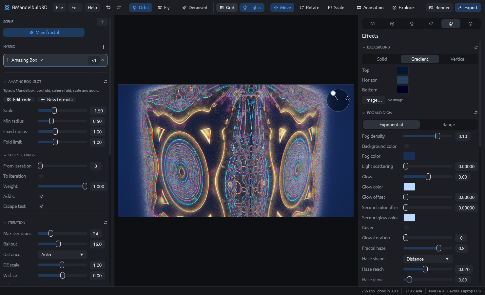
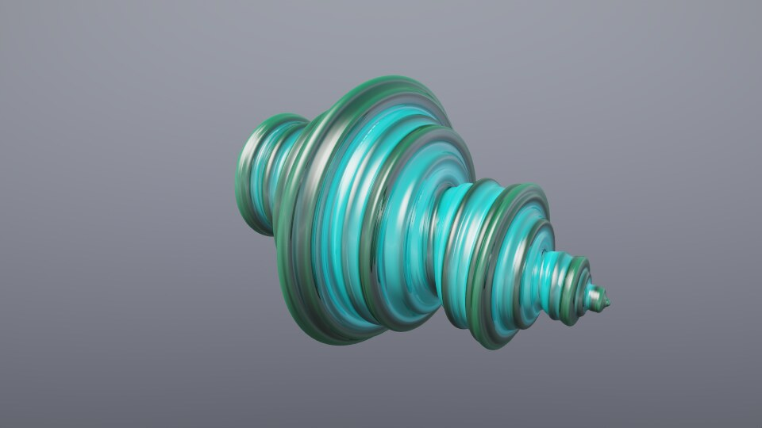

# Introduction

RMandelbulb3D is a program for exploring and rendering three-dimensional fractals: the
Mandelbulb, the Mandelbox, kaleidoscopic IFS shapes, quaternion Julia sets and hundreds of
other formulas, alone or mixed into hybrids. It is a re-implementation of
[Mandelbulb3D](https://github.com/thargor6/mb3d) in the Rust programming language. It opens
Mandelbulb3D's parameter files, contains its formulas, and renders on the graphics card (GPU)
with a modern, calm user interface.

This manual describes RMandelbulb3D version **{{version}}**. It explains every part of the
program: the main window, navigation, formulas and hybrids, the formula editor, scene
composition with shapes and 3D models, lighting, colors, effects, animation, rendering and
export.

## What RMandelbulb3D can do

- **Explore fractals** interactively: orbit around the surface or fly into it, with a preview
  that refines within seconds and stays fast while you move.
- **Build hybrids** of up to nine formula slots, each with its own iteration count and
  parameters, with Julia mode, 4D rotation, two combined formula chains (DE combination) and
  interpolation of two formulas.
- **Write your own formulas** in a small formula language, in the built-in formula editor. Each
  formula runs on the GPU and on the CPU from the same text.
- **Compose scenes**: add further fractals, basic shapes (box, sphere, torus, water and more)
  and 3D models (OBJ, STL, PLY, glTF, FBX) to the main fractal, and add, cut away or intersect
  them, also with smooth blends.
- **Light and color**: up to eight lights (directional, point, spot, area and line lights) with
  soft shadows and lens flares, ambient occlusion, optional path tracing, gradients with glowing
  colors and glow bands, texture layers, reflections and glass, fog, glow and fractal haze.
- **Finish the image** with depth of field, bloom, streaks, white balance, split toning and an
  AI denoiser.
- **Animate** with keyframes and recorded flights, smooth camera paths and motion blur, and
  export movies or image sequences.
- **Start quickly** from presets, batches of random fractals or variants of the current scene
  in the explore lane.

## RMandelbulb3D, Mandelbulb3D and Mandelbulber

RMandelbulb3D follows Mandelbulb3D closely: the way hybrids are built ("repeat from", DE
combination, interpolation hybrids), the distance estimates, the color index and much of the
lighting work the same way. It reads Mandelbulb3D's `.m3p` parameter files and the text
parameters that Mandelbulb3D users share in forums (`Mandelbulb3Dv18{…}`), and maps the
formulas, lights, colors, fog, depth of field and more to its own settings. More than 470 of
Mandelbulb3D's formulas, including the dIFS formulas, come translated and built in. Chapter 8
describes the import in detail.

A few ideas come from Mandelbulber 2, the other well-known 3D fractal program:

- the per-slot settings of a hybrid (iteration range, weight, adding the constant, escape test),
  minimum iterations and the constant factor;
- the scene composition with boolean operations (Mandelbulber's "boolean mode");
- the iteration fog, available as one shape of the fractal haze.

RMandelbulb3D does not open Mandelbulber files.

What is different from Mandelbulb3D:

- **GPU rendering.** The preview and all exported images render on the graphics card. A CPU
  renderer computes the same images and serves as the reference and as a fallback.
- **Progressive rendering.** The image starts grainy and becomes smoother with every pass, so
  soft shadows, ray traced ambient occlusion, depth of field and area lights look natural.
- **Deep zooms** with double precision on the GPU, switched on automatically when the zoom
  needs it.
- **One window** with panels instead of several windows. Settings sit in the scene panel on the
  left and in the inspector on the right.
- **Scenes as text.** Scenes are saved as readable `.rmb` files; exported PNG images carry the
  scene inside, so opening the image brings the scene back.

## System requirements

| Component | Requirement |
|-----------|-------------|
| Graphics | A GPU that `wgpu` supports (Vulkan, Metal or DirectX 12). Without one, the preview renders on the CPU, much slower and at a small size; exporting images needs the GPU. |
| Optional: denoiser | Intel® Open Image Denoise. If its library is found, the "Denoised" preview and the Denoise option of saved images work; otherwise the program runs without them and says why in the hover texts. |
| Optional: ffmpeg | For movies (MP4, MOV, WebM, GIF). It must be on the search path, or chosen in **Edit › Preferences… › Movies**. Without it, animations are saved as numbered PNG images. |

The denoiser library is looked for in the folder named by the environment variable
`RMB_OIDN_DIR`, next to the program, and in the system's library path.

## Starting the program

Start `rmb-app`. To open a scene directly, pass its file name (an `.rmb` scene, a
Mandelbulb3D `.m3p` file or a PNG rendered by RMandelbulb3D) as the first argument, or drop the
file onto the open window.

The program starts with a Mandelbulb. Chapter 2 walks you through a first session.

### Where RMandelbulb3D keeps its files

| What | Where |
|------|-------|
| Preferences | `rmandelbulb3d/prefs.json` in your configuration folder (`~/.config` on Linux, `%APPDATA%` on Windows) |
| Your formulas | `rmandelbulb3d/formulas/` in the same configuration folder (**Edit › Preferences… › Formulas › Open folder**) |
| Baked 3D models | `rmandelbulb/models/` in your cache folder (`~/.cache` on Linux), at most about 2 GB |

## About this manual

- Menu commands are written as **File › Export image…**: the menu, then the command.
- Keys are shown as <kbd>Ctrl</kbd>+<kbd>E</kbd>.
- Almost every control shows a short explanation when you hold the mouse over it. This manual
  explains the same controls in more depth.

The chapters:

| Chapter | Content |
|---------|---------|
| 2 | Getting started: a guided first session |
| 3 | The interface: top bar, scene panel, view, inspector, status bar |
| 4 | Camera and navigation |
| 5 | Fractals and hybrids: formulas, slots, iteration settings |
| 6 | The formula editor and the formula language |
| 7 | Scene composition: shapes, further fractals and 3D models |
| 8 | Mandelbulb3D parameters and formulas |
| 9 | Ray marching: detail, steps, precision |
| 10 | Lighting |
| 11 | Color |
| 12 | Effects: background, fog and glow, depth of field, cutting planes |
| 13 | Image and post processing |
| 14 | Animation |
| 15 | Rendering and export |
| 16 | The explore lane and the preferences |
| 17 | How-tos: step-by-step recipes |
| 18 | Reference: shortcuts and lists |
