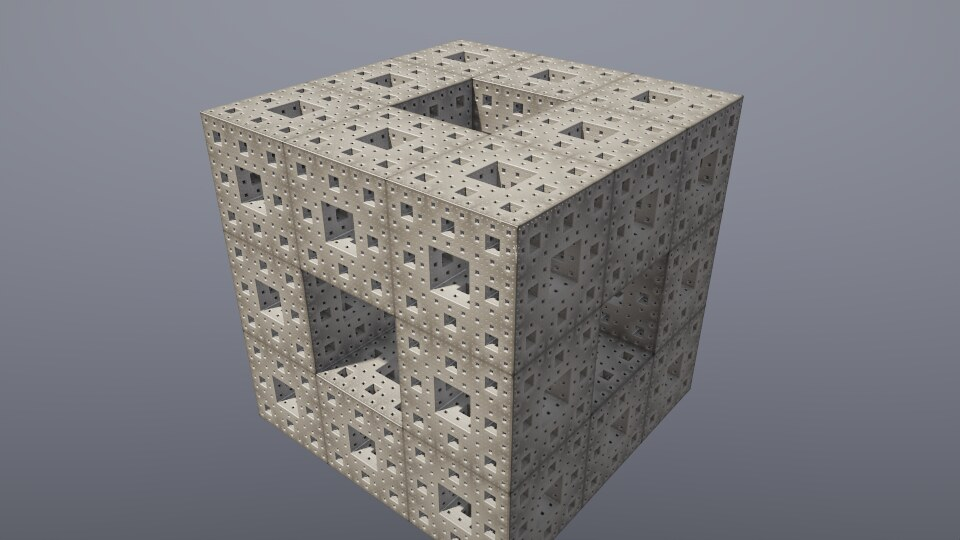
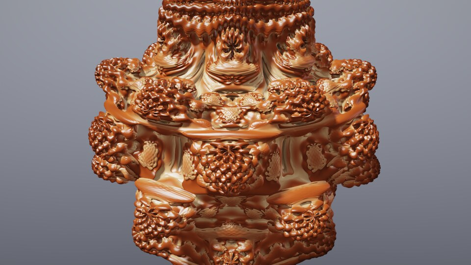

# Getting started

This chapter takes you through a first session: from the default Mandelbulb to a saved image.
It touches every part of the window once; the later chapters explain each part in depth.

## The window

When RMandelbulb3D starts, it shows a Mandelbulb in the middle of the window:

- On the **left**, the scene panel: the scene's objects and, below them, the formulas of the
  main fractal with their parameters.
- In the **middle**, the view: the live preview of the image.
- On the **right**, the inspector with six tabs: Camera, Ray marching, Lighting, Color, Effects
  and Notes.
- At the **top**, the top bar with the menus and switches; at the **bottom**, the status bar.

The preview refines continuously. It starts grainy and becomes smoother until it reaches the
number of samples set in the preferences. The status bar shows the progress as "spp" (samples
per pixel) and, when the preview is complete, how long it took ("done in 3.2 s").

## Look around

The view starts in **Orbit** mode:

- **Drag with the left mouse button** to orbit around the point of the surface where you
  started the drag.
- **Turn the mouse wheel** to move toward the point under the cursor, or away from it.
- **Drag with the right mouse button** to pan the view.
- **Double-click** a point of the surface to look at it. This also sets the focus distance of
  the depth of field to that point.

While you move, the preview renders at a lower resolution so it can follow you; it sharpens
again a moment after you stop.

!!! tip
    If you get lost, open the **Camera** tab and click **Reset view**. The camera goes back to
    its start position, looking at the center of the scene.

For flights into the fractal, press <kbd>Tab</kbd> to switch to **Fly** mode and move with
<kbd>W</kbd> <kbd>A</kbd> <kbd>S</kbd> <kbd>D</kbd>. Chapter 4 explains both modes.

## Pick a starting point

Click **Explore** in the top bar. A lane with thumbnails opens below the view. Its **Presets**
tab holds scenes to start from: a Mandelbulb, an Amazing Box, a Menger sponge, a kaleidoscopic
IFS, a quaternion Julia set, a neon box city, a glass bulb and a hybrid.

Click a thumbnail to take that scene. It replaces the current one; <kbd>Ctrl</kbd>+<kbd>Z</kbd>
brings the previous scene back. The **Random** tab makes batches of random fractals and the
**Mutations** tab variants of the current scene (chapter 16).

## Change a formula parameter

The scene panel on the left shows the **hybrid**: the list of formula slots. A simple scene has
one slot, for example "Mandelbulb ×1". Click a slot to select it. Below the list, the section
titled with the formula's name and the slot number ("Mandelbulb · slot 1") holds the formula's
parameters.

1. Drag the **Power** slider of the Mandelbulb, for example from 8 to 5. The preview updates
   at once.
2. Double-click the slider to set it back to its default.
3. Click the formula name in the slot to open the formula list, type a few letters to search
   and pick another formula.

Below the parameters, the **Iteration** section sets the number of iterations and the
bailout. More iterations give finer detail. Chapter 5 covers formulas and hybrids.

## Colors

Open the **Color** tab of the inspector. The **Gradient** section shows the colors of the
surface as a strip:

- **Presets** replaces the colors with a built-in gradient or one of your saved palettes.
- **Random** makes a new random palette.
- Drag a marker on the strip to move a color, click the strip to add a color, right-click a
  marker to remove it.

The **Mapping** section below decides which value of the fractal picks the color (**Color
by**) and how fast the colors change (**Scale**, **Offset**). Chapter 11 explains colors in
depth; chapter 10 covers lights.

## Test render

Press <kbd>F12</kbd> or click **Render** in the top bar. The render window renders the scene
with everything a saved image gets: the denoiser (when **Effects › Image › Denoise** is on),
lens flares, bloom and streaks. Choose a **Size** (25, 50 or 100 % of the image size) and a
number of **Samples**, then click **Render**. Changes to the post processing (**Effects ›
Image**) show in the render window at once, without rendering again. **Save PNG…** saves the
image as shown.

## Export the image

Press <kbd>Ctrl</kbd>+<kbd>E</kbd> or click **Export** in the top bar:

1. Set the **Width** and **Height**, or use the **Scale** buttons (½×, 1×, 2×, 4×) relative to
   the image size of the scene. The height follows the aspect of the scene.
2. Set the **Samples**: more samples give smoother soft shadows, occlusion and depth of field.
3. Click **File…** and choose where to save the PNG.
4. Click **Render and save**.

The image size of the scene itself is set in **Camera › Image size**, where buttons like 1080p,
4K or 9:16 set common sizes. Chapter 15 covers rendering and export.

## Save the scene

- **File › Save** (<kbd>Ctrl</kbd>+<kbd>S</kbd>) saves the scene as an `.rmb` file. The first
  time, it asks for a name.
- **File › Save as…** (<kbd>Ctrl</kbd>+<kbd>Shift</kbd>+<kbd>S</kbd>) saves under a new name.
- **File › Open…** (<kbd>Ctrl</kbd>+<kbd>O</kbd>) opens `.rmb` scenes, Mandelbulb3D `.m3p` files,
  text files with Mandelbulb3D parameters and PNG images rendered by RMandelbulb3D.
- **File › Open recent** lists the last files you opened or saved.

Every PNG that RMandelbulb3D saves, from the export or from the render window, carries the
complete scene inside. Open the PNG (or drop it onto the window) to continue where you left
off.

!!! note
    A scene that uses your own or edited formulas carries their code along, so it renders on
    any computer with RMandelbulb3D, even where those formulas are not installed.

The window title shows the file name; a dot (•) after it means there are unsaved changes. If
you close the program with unsaved changes, it asks whether to **Save**, **Discard** or
**Cancel**.

## Copy and paste scenes

- **Edit › Copy scene** (<kbd>Ctrl</kbd>+<kbd>C</kbd>) copies the scene as text, for example to
  paste into a message or into a second RMandelbulb3D window.
- **Edit › Paste scene** (<kbd>Ctrl</kbd>+<kbd>V</kbd>) loads a scene from the clipboard: an
  RMandelbulb3D scene or Mandelbulb3D text parameters (they start with `Mandelbulb3Dv18{`).

Pasting is one undo step, so <kbd>Ctrl</kbd>+<kbd>Z</kbd> brings the previous scene back. When
an import could not convert everything, the **Notes** tab opens and lists what is missing
(chapter 8).

!!! note
    <kbd>Ctrl</kbd>+<kbd>C</kbd> and <kbd>Ctrl</kbd>+<kbd>V</kbd> copy and paste scenes only while
    no text field has the keyboard focus. Inside a text field they copy and paste text as usual.

## Where to go next

- Chapter 3 describes every part of the window.
- Chapter 5 shows how to build hybrids of several formulas.
- Chapter 17 has step-by-step recipes for common tasks.
- Press <kbd>F1</kbd> for the help window with a short guide, the shortcuts and the list of all
  formulas.
