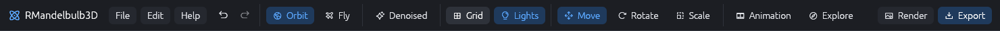
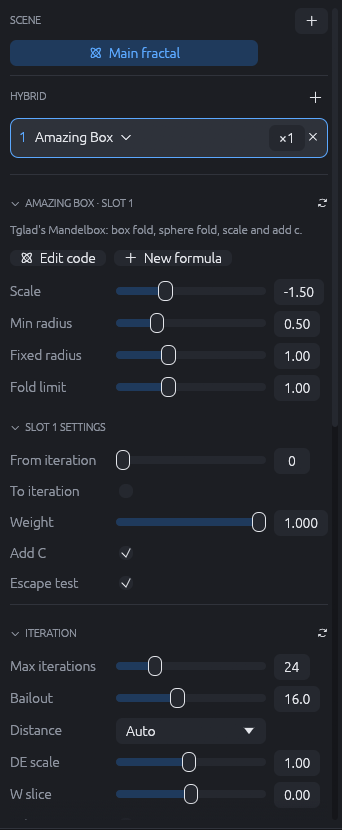

# The interface

RMandelbulb3D has one main window. Its parts are always in the same place:

| Area | Position | Purpose |
|------|----------|---------|
| Top bar | top | Menus, undo/redo, navigation mode, view switches, gizmo modes, the Animation and Explore lanes, Render and Export |
| Scene panel | left | The scene's objects, the formulas of the selected fractal with their parameters, or the settings of the selected object |
| View | center | The live preview with the navigation, the light and object handles and the guides |
| Inspector | right | Six tabs: Camera, Ray marching, Lighting, Color, Effects, Notes |
| Lanes | bottom (optional) | The explore lane and the animation timeline, when switched on |
| Status bar | bottom | Messages, the preview's progress, image size and graphics card |

The scene panel and the inspector can be made wider by dragging their inner edge.

## The top bar

From left to right:

- The **File**, **Edit** and **Help** menus (see below).
- **Undo** and **Redo**.
- **Orbit** and **Fly**: the navigation mode of the view (chapter 4). <kbd>Tab</kbd> switches
  between them while the view has the keyboard focus.
- **Denoised** shows the preview through the AI denoiser. The denoised image updates at 1, 4,
  16, 64, … samples. It only changes the preview; saved images are denoised when **Effects ›
  Image › Denoise** is on. The button is disabled without the GPU renderer; its hover text says
  why when the denoiser library is missing.
- **Grid** shows the ground grid (the plane z = 0) with the x (red), y (green) and z (blue)
  axes, and an axis cross in the corner of the view. Click an end of the axis cross to look
  along that axis.
- **Lights** draws the lights in the view with handles to move and aim them. Clicking a light
  selects it and opens it in the Lighting tab (chapter 10).
- **Move**, **Rotate** and **Scale** choose what the handles of the selected object do
  (chapter 7). Select an object in the scene panel or <kbd>Ctrl</kbd>+click it in the view.
- **Animation** shows the timeline below the view (chapter 14).
- **Explore** shows the explore lane below the view (chapter 16).
- On the right: the file name, **Render** (<kbd>F12</kbd>), the test render window, and
  **Export** (<kbd>Ctrl</kbd>+<kbd>E</kbd>). While they work, the buttons read "Rendering…" and
  "Exporting…".

When the window is too narrow for all labels, the top bar shows only the icons; their hover
texts then start with the name of the button. The file name is shown only where there is room.

## Menus

### File

| Command | Shortcut | What it does |
|---------|----------|--------------|
| New | <kbd>Ctrl</kbd>+<kbd>N</kbd> | A new scene with the default Mandelbulb. |
| Open… | <kbd>Ctrl</kbd>+<kbd>O</kbd> | Opens RMandelbulb3D scenes (`.rmb`), Mandelbulb3D `.m3p` files and text parameters (`.txt`), and PNGs rendered by RMandelbulb3D. You can also drop a file onto the window. |
| Open recent | | The last twelve files you opened or saved. |
| Save | <kbd>Ctrl</kbd>+<kbd>S</kbd> | Saves into the open `.rmb` file (asks for a name the first time). |
| Save as… | <kbd>Ctrl</kbd>+<kbd>Shift</kbd>+<kbd>S</kbd> | Saves under a new name. |
| Export image… | <kbd>Ctrl</kbd>+<kbd>E</kbd> | Renders and saves a PNG (chapter 15). |
| Export animation… | | Renders the keyframe animation. Available once the timeline has keyframes. |
| Quit | <kbd>Ctrl</kbd>+<kbd>Q</kbd> | Closes the program. With unsaved changes it asks first. |

An opened Mandelbulb3D file or PNG is not linked to its file name: **Save** asks for a name for
the new `.rmb` file.

### Edit

| Command | Shortcut | What it does |
|---------|----------|--------------|
| Undo / Redo | <kbd>Ctrl</kbd>+<kbd>Z</kbd> / <kbd>Ctrl</kbd>+<kbd>Shift</kbd>+<kbd>Z</kbd> (or <kbd>Ctrl</kbd>+<kbd>Y</kbd>) | Steps back and forth through the changes. |
| Copy scene | <kbd>Ctrl</kbd>+<kbd>C</kbd> | Copies the scene as text. |
| Paste scene | <kbd>Ctrl</kbd>+<kbd>V</kbd> | Loads an RMandelbulb3D scene or Mandelbulb3D text parameters from the clipboard. |
| Preferences… | | Settings that stay between sessions (chapter 16). |

### Help

- **Help** (<kbd>F1</kbd>) opens the help window with the tabs *Getting started*, *Shortcuts*,
  *Formulas*, *Formula language* and *About*.
- **Formula reference** opens the help window on the list of all formulas, sorted by category,
  with their descriptions and their Mandelbulb3D names. Formula files with errors are listed
  at the end.
- **About** shows the version and the license.

## The scene panel

The upper part, **SCENE**, lists the main fractal and the objects combined with it (chapter 7).
Click an entry to edit it. The **+** button adds an object.

Below it, the panel shows the settings of the selected entry. For the main fractal these are:

- **HYBRID**: the formula slots (chapter 5).
- The parameters of the selected slot, with the buttons **Edit code** and **New formula** for the
  formula editor (chapter 6).
- **Slot settings** of the selected slot, **Iteration**, **Two chains** and **Placement**
  (chapter 5).

## The view

The view shows the image in the aspect ratio of the image size (**Camera › Image size**), with
a thin frame around it. In the preferences, **Image aspect** switches this off, so the preview
fills the whole view.

The preview works in passes. Every pass adds one sample per pixel, and the image gets
smoother until it reaches the number of samples set in **Preferences › Preview › Samples**.
Every change starts it again.

While you navigate, the preview switches to a **fast mode**: it renders one sample at a lower
resolution (**Preferences › Preview › While moving**, in percent) and leaves out shadows. A
quarter of a second after the last move it returns to the full preview.

When the view and the settings rest for a moment, the preview compiles an optimized version of
the renderer in the background and continues with it (**Preferences › Preview › Optimize at
rest**). The image stays the same; passes get faster.

Messages appear in the top left corner of the view:

- "Compiling shader…": the renderer is being prepared for new formulas or settings. The first
  compile of a scene can take a few seconds.
- "Deep zoom: double precision (slower)": see chapter 9.
- "Formulas not available": slots whose formula is not in the library. They are skipped.
- "The camera is inside the fractal": move out (fly backward, mouse wheel), use **Camera ›
  Reset view**, or turn on **Inside** rendering (chapter 5).
- Errors of the renderer, in orange.

### Picking

Several actions look at the surface under the mouse pointer:

- Orbiting turns around the surface point where the drag starts.
- The mouse wheel moves toward the surface point under the pointer.
- A double-click looks at the point and sets the focus distance.
- <kbd>Ctrl</kbd>+click selects the object under the pointer: the main fractal or a composed
  object.

## The inspector

The inspector on the right has six tabs, chosen with the icons at its top:

| Tab | Content | Chapter |
|-----|---------|---------|
| Camera | Navigation, position and field of view, image size | 4 |
| Ray marching | Detail, steps, distances, smooth normals, precision | 9 |
| Lighting | Lights, ambient light, global illumination, ambient occlusion | 10 |
| Color | Gradient, glow bands, mapping, emissive colors, texture layers, color map | 11 |
| Effects | Background, fog and glow, depth of field, cutting planes, image | 12, 13 |
| Notes | Free text saved with the scene | below |

### Notes

The Notes tab holds free text that is saved with the scene: the title, authors or anything you
want to remember. When you open or paste Mandelbulb3D parameters, the import writes the title,
the authors and its notes here. If something could not be converted, the tab opens by itself
and the list under "Import notes:" says what (chapter 8).

## Working with the controls

- **Sections.** Settings are grouped into sections with a title in capitals. Click a title to
  close or open the section. RMandelbulb3D remembers which sections you closed, also after a
  restart.
- **Reset buttons.** Many section titles have a small reset button on the right. It sets the
  whole section back to its defaults.
- **Double-click to reset.** A double-click on a slider or number field sets it back to its
  default value.
- **Typing values.** Sliders have a soft range: you can type values outside it into the number
  field.
- **Hover texts.** Almost every control explains itself when you hold the mouse over it.

## Undo

RMandelbulb3D keeps the last 200 steps. A drag on a slider or in the view counts as one step,
recorded when you release the mouse button. Taking a scene from the explore lane and pasting a
scene are single steps too. Opening a file or starting a new scene clears the history.

## The status bar

On the left, the status bar shows what the last action did, for example "Saved scene.rmb" or
why an action failed. Messages disappear after a few seconds; warnings, shown in orange, stay
longer.

On the right, from right to left:

- the graphics card (or "CPU" without one);
- the size of the preview in pixels;
- the samples per pixel of the preview, and "done in …" when it is complete;
- what the denoiser did, while **Denoised** is on;
- the position of the mouse pointer over the image, from −1 to +1 in both directions.
