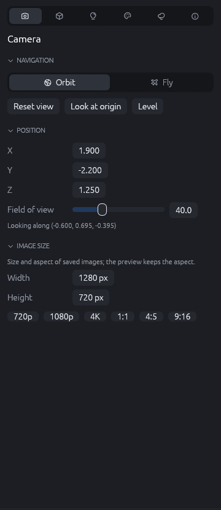

# Camera and navigation

The camera decides what the image shows: where it stands, where it looks and how wide its view
is. You move it mostly with the mouse in the view; the **Camera** tab of the inspector holds the
exact values and the image size.

RMandelbulb3D has two ways to move the camera:

- **Orbit** turns around a point of the surface. It is the natural way to look at a fractal
  from all sides and to zoom in on a detail.
- **Fly** moves like a first-person game or a drone. It is the way to travel into a fractal,
  through its holes and along its surfaces.

Switch between them with **Orbit** and **Fly** in the top bar, in the Camera tab, or with
<kbd>Tab</kbd> while the view has the keyboard focus. The view takes the focus when you click it,
or when the mouse is over it and no text field has the focus.

## Orbit mode

| Action | Result |
|--------|--------|
| Left drag | Orbits around the surface point where the drag starts. If there is no surface there, around the last point; otherwise around a point ahead of the camera. |
| <kbd>Shift</kbd> + left drag, or middle drag | Looks around: the camera turns in place. |
| Right drag | Pans: moves the camera sideways and up or down, so the surface follows the mouse. |
| Mouse wheel | Moves toward the surface point under the pointer (or away from it). Each step covers a part of the distance, so you can zoom in as far as you like and never pass through the surface. |
| Double-click | Looks at the point under the pointer and sets the focus distance of the depth of field there. The point also becomes the center for orbiting. |
| <kbd>Ctrl</kbd> + click | Selects the object under the pointer (chapter 7). |

!!! tip
    To zoom in on a detail, point at it and turn the wheel. Then double-click it to center it
    and orbit around it.

## Fly mode

| Action | Result |
|--------|--------|
| <kbd>W</kbd> / <kbd>S</kbd> | Forward / backward |
| <kbd>A</kbd> / <kbd>D</kbd> | Left / right |
| <kbd>R</kbd> / <kbd>F</kbd> | Up / down |
| <kbd>Q</kbd> / <kbd>E</kbd> | Roll left / right |
| Arrow keys | Turn left, right, up and down |
| <kbd>Shift</kbd> (held) | Four times faster |
| Left or middle drag | Look around |
| Right drag | Pan |
| Mouse wheel | Changes the flying speed (from ×0.01 to ×100) |
| <kbd>Space</kbd> | Mouse look on or off |
| Double-click | Looks at the point and sets the focus distance |

The keys also work in Orbit mode, as long as the view has the keyboard focus.

The speed follows the distance to the nearest surface: far away the camera moves fast, close to
the surface it slows down. This keeps flying controllable at any zoom, also deep inside the
fractal. The wheel multiplies this speed; the current factor shows at the bottom of the view,
together with a reminder of the keys.

### Mouse look

Press <kbd>Space</kbd> in Fly mode to capture the mouse: the pointer disappears and every mouse
move steers the camera, without stopping at the edge of the window. You can turn all the way
around and fly loops. Press <kbd>Space</kbd> or <kbd>Esc</kbd> to release the mouse. Mouse look
also ends when you switch to Orbit mode or another window gets the focus.

!!! tip
    Fly mode is also the way to record a flight for an animation: the timeline creates keyframes
    along your flight (chapter 14).

## Guides

With **Grid** switched on in the top bar, the view shows:

- the **ground grid** on the plane z = 0, with fine lines near the camera and coarser lines
  farther out; the spacing adapts to the camera's height;
- the **x axis** (red), the **y axis** (green) and the **z axis** (blue, up);
- the **axis cross** in the corner of the view. Hold the mouse over one end of an axis and
  click to look along that axis, for example straight down onto the fractal.

The world's up direction is +z. Light positions, object placement and the cutting planes all
use these world axes.

## The Camera tab

### Navigation

The **Orbit** and **Fly** buttons switch the navigation mode, like the ones in the top bar.
Below them:

| Button | What it does |
|--------|--------------|
| Reset view | Puts the camera back to the default position, looking at the origin. |
| Look at origin | Turns the camera toward the point (0, 0, 0). |
| Level | Removes the roll, so that +z points up on the screen again. |

### Position

| Setting | What it does | Default |
|---------|--------------|---------|
| X, Y, Z | The camera position along the world axes (not left/right or forward/back of the view). Drag the number or type a value. | 1.9, −2.2, 1.25 |
| Field of view | The vertical opening angle in degrees. Small values zoom in like a telephoto lens and flatten the depth; large values give a wide-angle look. | 40° (5–120) |

Below the values, "Looking along (…)" shows the viewing direction.

### Image size

The size and aspect of saved images. The preview keeps the same aspect ratio.

| Setting | What it does | Default |
|---------|--------------|---------|
| Width, Height | Image size in pixels (16 to 16384). | 1280 × 720 |
| 720p, 1080p, 4K | 1280 × 720, 1920 × 1080, 3840 × 2160 | |
| 1:1, 4:5, 9:16 | 1080 × 1080, 1080 × 1350, 1080 × 1920 (square, portrait, phone screen) | |

The export can still render at another size (chapter 15).

## Deep zoom

Fractals have detail at every scale, and the mouse wheel lets you zoom in without limit. At
some point the numbers of the graphics card run out of precision and the surface gets grainy
and blocky. RMandelbulb3D then switches to double precision by itself, and the view shows
"Deep zoom: double precision (slower)". This reaches zooms of about 1e11.

The setting behind it is **Precision** in the **Ray marching** tab (Auto, Single or Double);
chapter 9 describes it.

## Mouse settings

In **Edit › Preferences… › Navigation**:

| Setting | What it does | Default |
|---------|--------------|---------|
| Mouse speed | Sensitivity of orbiting and looking around. | 1.0 (0.1–4) |
| Invert Y | Inverts the vertical mouse direction. | off |

## When the camera is inside the fractal

If the camera ends up inside the solid part of the fractal, the image goes dark or shows
nothing useful, and the view says "The camera is inside the fractal". Fly backward, turn the
mouse wheel, or use **Reset view**. For views from within the fractal on purpose, turn on
**Inside** in the Iteration section (chapter 5): the empty space and the solid then swap.
