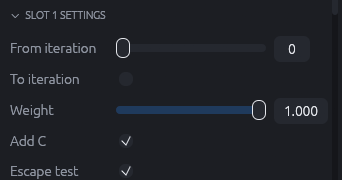
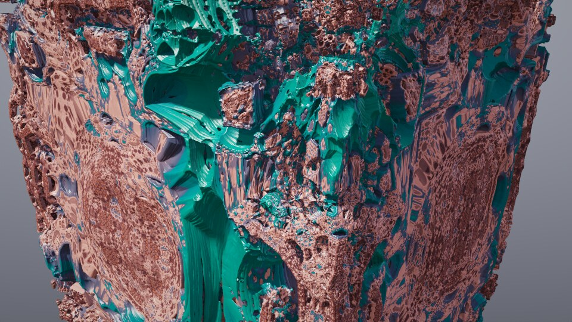

# Fractals and hybrids

A 3D fractal in RMandelbulb3D is made by a **formula** that is applied to every point of space
again and again. Some points stay close to the center no matter how often the formula runs;
others fly away after a few rounds ("escape"). The boundary between the two is the fractal's
surface. To find that surface, the renderer sends rays from the camera and asks at every step:
how far is the surface from here? This **distance estimate** lets the ray take large steps in
empty space and small ones close to the surface.

Several formulas can work together on the same point: one after the other, each for a number of
rounds. Such a chain is a **hybrid**, and most of the striking Mandelbulb3D images are hybrids.

The formulas of the main fractal are edited in the scene panel on the left, with **Main
fractal** selected in the scene list.

## The hybrid chain

The **HYBRID** list shows the formula slots, one card per slot:

- the **slot number**, dimmed when the slot is switched off;
- the **formula name**: click it to choose another formula;
- a warning sign when the formula is not available (the slot is then skipped);
- the buttons to move the slot up or down and to remove it (×);
- the **iteration count** (×1, ×2, …): how many times in a row the slot runs its formula.

Click a card to select the slot; its parameters and settings show below the list. The **+**
button next to the HYBRID title adds a slot, up to nine.

### How the chain runs

For every point, the chain runs the formula of slot 1 as often as its iteration count says,
then the formula of slot 2, and so on. After the last slot it starts again, and it goes on
until the point escapes or the maximum number of iterations is reached (**Iteration › Max
iterations**).

With two or more slots, **Repeat from** chooses where the chain starts again after the last
slot (Mandelbulb3D's "repeat from"). Slots before it run only once, at the start. This is useful
for formulas that should only prepare the point, such as a rotation or a fold before the main
formula.

- An iteration count of **0** switches the slot off without removing it.
- A double-click on the iteration count sets it back to 1.
- When you choose a new formula for a slot, its parameters go back to the formula's defaults.

**Transform** formulas (rotate, scale, fold and similar; see "Formula families" below) only move
the point. They do not count as an iteration, and the escape test does not run after them, like
in Mandelbulb3D.

### Choosing a formula

Clicking the formula name opens the formula list. The formulas are grouped by category. Type into
the search field to filter the list: the search looks at the formula names, their Mandelbulb3D
names and their descriptions. Hold the mouse over a formula to read its description.

## Formula parameters

The section below the list is titled with the formula's name and the slot number, for example
"Amazing Box · slot 2". It shows the formula's description and its parameters:

- **Numbers** as sliders. The slider range is a suggestion; you can type any value.
- **Whole numbers** as number fields.
- **Switches** as checkboxes.
- **Angles** as sliders in degrees.

The hover text of each parameter shows its name in the formula code and its default value. A
double-click sets a parameter back to its default; the reset button of the section resets all
parameters of the slot.

The buttons **Edit code** and **New formula** open the formula editor (chapter 6). For formulas
that do not come with the program, the section also shows where the formula came from.

## Slot settings

The section **Slot N settings** holds per-slot settings in the style of Mandelbulber 2. They
apply to the slots of the main fractal. As long as all are at their defaults, the section has
no reset button.

| Setting | What it does | Default |
|---------|--------------|---------|
| From iteration | The slot runs only from this iteration on; before it, the chain skips the slot. Transforms do not count. | 0 (from the start) |
| To iteration | When switched on, the slot runs only up to this iteration (inclusive) and is skipped after it. | off (5 when switched on) |
| Weight | Share of the formula's result. Below 1 the point blends with where it was before the formula, for soft transitions between formulas. | 1 |
| Add C | The formula adds the constant: the point's position (or the Julia constant). Off: it runs as if the constant were zero (Mandelbulber's "don't add c"). | on |
| Escape test | Tests for escape after this slot. Off: points may grow past the bailout here and come back in later slots (Mandelbulber's "check for bailout"). | on |

!!! tip
    **From iteration** and **To iteration** let one formula shape the coarse form and another
    the fine detail: for example a Mandelbulb for the first four iterations and an Amazing Box
    from then on.

## Iteration

| Setting | What it does | Default |
|---------|--------------|---------|
| Max iterations | Iterations per point, all slots together. More iterations give finer detail and render slower. | 12 (1–100) |
| Bailout | Escape radius: a point escapes when its distance from the origin exceeds this. | 4 (1–1024) |
| Distance | How the distance to the surface is estimated (see below). | Auto |
| DE scale | Multiplies the distance estimate. Lower it if the surface shows holes or noise. | 1 (0.05–2) |
| W slice | Start value of the fourth dimension, for 4D formulas. | 0 |
| Julia | Uses a fixed constant for every point instead of the point's position. Shows **Julia X**, **Y**, **Z** and **W**, the constant. | off |
| Inside | Renders the inside of the set: escaping points become solid, the set becomes empty space. For views from within the fractal; slower, because the rays take small steps. | off |
| Rotate XW, YW, ZW | Rotate the start point into the fourth dimension, for formulas that use w. | 0° |
| Min iterations | No point escapes before this many iterations. Fills thin or empty parts of hybrids whose first formulas throw points out. | 0 (0–50) |
| C factor X, Y, Z | Multiply the constant per axis before the formulas add it (Mandelbulber's constant factor). | 1 |

The reset button of the section resets all of these; it keeps the slots, **Repeat from** and
the placement.

### Distance estimate

| Mode | Use |
|------|-----|
| Auto | The formula's own estimate (each formula says which kind it needs). Right for most scenes. |
| Analytic (log) | The estimate for power formulas such as bulbs and quaternions. |
| Analytic (linear) | The estimate for folding formulas such as boxes, sponges and IFS. |
| Numeric (log) | Measured from the neighborhood of the point instead of computed alongside the formula. Slower, but works for every hybrid; the log kind suits hybrids with bulbs. |
| Numeric (linear) | The same for hybrids with boxes. |

!!! tip
    Holes, noise or "dust" on the surface mean the estimate is too large and rays step through
    the surface. Lower **DE scale** here or **Step** in the Ray marching tab. A hybrid of a bulb
    and a box often looks cleaner with a numeric estimate.

## Two chains

The section **Two chains** (inside the Iteration section) offers two ways of letting formulas
work side by side instead of one after the other. Both need at least two slots.

### Interpolate slots 1 and 2

Every iteration runs the formulas of slots 1 and 2 on the same point and blends their results
(Mandelbulb3D's interpolation hybrid). **Weight 1** and **Weight 2** set the share of each
(default 0.5 each; values below 0 and above 1 are possible). The other slots are not used.

### DE combination

**DE combination** splits the slots into two chains. Each chain makes its own fractal with its
own iteration limit, and their distance estimates are combined into one shape (Mandelbulb3D's DE
combination). In the slot list, the label **CHAIN 2** marks where the second chain starts.

| Setting | What it does |
|---------|--------------|
| Combine | How the two shapes are combined (see below). |
| Chain 2 from | The first slot of the second chain. |
| Repeat from | Where the second chain continues after its last slot. |
| Iterations 2 | Maximum iterations of the second chain. |
| Blend | Distance over which the two shapes blend, in world units (only for the blend modes and **Subtract second**). Default 0.05. |

| Combine mode | Result |
|--------------|--------|
| Union (min) | Both shapes together. |
| Intersection (max) | Only where both shapes overlap. |
| Subtract second | The first shape with the second cut away. |
| Union, linear blend | Both shapes, joined with a straight blend over the blend distance. |
| Union, smooth blend | Both shapes, melted into each other over the blend distance. |
| Mix (chain 1, then dIFS) | The first chain moves the point; the second chain, a dIFS formula, measures the distance there (Mandelbulb3D's "mix"). |

## Placement

The section **Placement** moves, turns and sizes the main fractal in the scene. It matters when
the scene has further objects (chapter 7), for example to set the fractal onto a ground plane.

| Setting | What it does |
|---------|--------------|
| X, Y, Z | Position along the world axes. **In front of the camera** moves the fractal to the middle of the view. |
| Turn X, Y, Z | Rotation in degrees, about x, then y, then z. A double-click sets 0. |
| Scale | Size as a whole. |
| Stretch X, Y, Z | Extra size along the fractal's own axes (1: none). A double-click sets 1. |

The reset button appears once the placement differs from the default. Composed objects and the
cutting planes stay where they are when you move the main fractal. Unlike composed objects, the
main fractal has no handles in the view; use the numbers.

## Formula families

The formula list groups the formulas by category:

| Category | Formulas |
|----------|----------|
| Bulbs | Mandelbulb and its variants (cosine, Mandelbar, Square bulb, Bristorbrot, Xenodreambuie, Folding bulb, Tricorn), Aexion C |
| Boxes | Amazing Box (Mandelbox), Amazing Surf, ABox Mod Kali, Kali box, Kaliset, Mandelbox 4D |
| IFS | Menger sponge, Sierpinski tetrahedron, Kaleidoscopic IFS, Octahedron |
| Kleinian | Pseudo Kleinian (Knighty), Jos Kleinian (Jos Leys' double-spiral groups). Limit sets that never escape: they run the full iteration count with their own distance estimate. Pseudo Kleinian is best seen from inside its halls with a wide field of view; Jos Kleinian lives in the slab between y = 0 and y = Klein R (the camera must be inside it). Both have presets in the explore lane. |
| Hypercomplex | Quaternion, Quaternion cubic, Hypercomplex, Mandelbrot 2D, Quaternion (MB3D) |
| Transforms | Rotate, Scale, Translate, Add C, Box fold, Sphere fold, Abs, Sphere inversion |
| Hybrids | Bulbox |
| MB3D 3D, MB3D 4D, MB3D dIFS, MB3D transforms | More than 470 formulas translated from Mandelbulb3D (chapter 8) |

Formulas you write yourself appear under their own category (chapter 6). The full list with
descriptions is in **Help › Formula reference**.

!!! note
    Composed fractal objects (chapter 7) have the same hybrid chain, parameters, Iteration and
    Two chains settings, but not the slot settings, **Inside**, the 4D rotation, **Min
    iterations** or the **C factor**.
