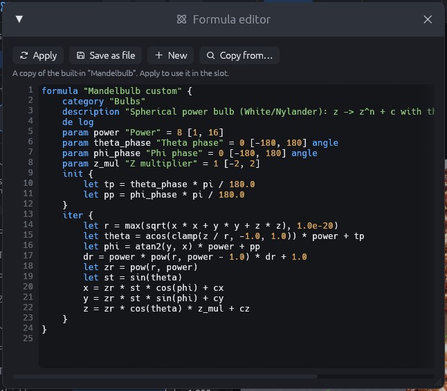

# The formula editor

Every formula in RMandelbulb3D is a short text in a small formula language. The same text runs
on the graphics card and on the CPU, so both renderers compute exactly the same fractal. You can
read the code of any formula, change it, or write a new one, without leaving the program: the
formula editor compiles it, adds it to the formula list and puts it into the slot you are
working on.

## Opening the editor

In the scene panel, the parameter section of the selected slot has two buttons:

- **Edit code** opens the formula of the slot. Formulas that come with the program open as a
  **copy** named "*Name* custom", so the original stays available.
- **New formula** opens a short example formula (a Mandelbulb) to start from.



The editor window has a code area with line numbers and syntax colors, and these buttons:

| Button | What it does |
|--------|--------------|
| Apply | Compiles the formula, adds it to the formula list and uses it in the selected slot (<kbd>Ctrl</kbd>+<kbd>Enter</kbd>). |
| Save as file | Saves the formula into your formula folder, so it loads at every start. The file is named after the formula. |
| New | Starts again from the example formula. |
| Copy from… | Starts from a copy of any formula in the library: built-in, Mandelbulb3D or yours. Type to search. |

A line under the buttons says what happened. When the code has an error, it names the line
("Error in line 12: unknown variable 'q'") and the line number turns orange in the margin.

After **Apply**, the renderer recompiles for the new formula; the view shows "Compiling
shader…" for a moment. If you apply a changed formula under a name that already exists, the new
version replaces the old one for this session.

!!! note
    A formula you only applied lives until you close the program. Scenes that use it carry its
    code along, so they still render after a restart and on other computers. **Save as file**
    keeps the formula in the formula list for good.

## Where formulas live

Your formula files (`*.mbf`) are kept in the folder `rmandelbulb3d/formulas/` of your
configuration folder (`~/.config` on Linux, `%APPDATA%` on Windows). **Edit › Preferences… ›
Formulas** shows the exact path and has two buttons:

- **Open folder** opens it in the file manager (and creates it if needed).
- **Reload formulas** loads the files again, after you changed them in another editor.

All files in the folder load at start. A file may hold several formulas. A formula with the
name of a built-in one replaces it. If a file has errors, the status bar says so after the
start, and **Help › Formula reference** lists the errors at the end.

When you open a scene that carries the code of its formulas, RMandelbulb3D adds those formulas
to the list, unless the list already has the same code.

## Importing Mandelbulb3D formulas

Mandelbulb3D stores its formulas as `.m3f` files: machine code, or Pascal source for the "JIT"
formulas. More than 470 of them come translated with RMandelbulb3D. To add others, use **Import
.m3f…** in **Edit › Preferences… › Formulas** and choose a folder. RMandelbulb3D translates every
`.m3f` file of the folder and reports how many it added and how many could not be translated.
The added formulas are available for this session; scenes that use them carry their code along.

## The formula language

A formula file holds one or more `formula` blocks:

```
formula "My bulb" {
    category "Bulbs"
    description "Shown as hover text"
    de log
    param power "Power" = 8 [2, 16]
    param flip "Flip" = 0 bool
    init {
        let half = power * 0.5
    }
    iter {
        let r = max(sqrt(x * x + y * y + z * z), 1.0e-20)
        let theta = acos(clamp(z / r, -1.0, 1.0)) * power
        let phi = atan2(y, x) * power
        dr = power * pow(r, power - 1.0) * dr + 1.0
        let zr = pow(r, power)
        x = zr * sin(theta) * cos(phi) + cx
        y = zr * sin(theta) * sin(phi) + cy
        z = zr * cos(theta) + cz
    }
}
```

Comments start with `//` and run to the end of the line. Semicolons are allowed but not needed.

### Formula items

| Item | Meaning |
|------|---------|
| `category "…"` | The group in the formula list. Default: "Other". |
| `description "…"` | Shown as hover text and in the formula reference. |
| `de log` / `linear` / `numeric` / `difs` / `maxaxis` / `custom` | The kind of distance estimate (see below). Default: `log`. |
| `param name "Label" = default [min, max] kind` | A parameter (see below). |
| `alias "Name" (p1, p2, …)` | Another name, used when importing Mandelbulb3D parameters (see below). |
| `transform` | The formula only moves the point: it does not count as an iteration and the escape test is skipped after it. |
| `iterations N` | The iteration count a slot gets when you choose this formula. |
| `descale N` | Multiplies the distance estimate when this formula is in the hybrid. |
| `init { … }` | Runs once per render. Its top-level `let` values become constants of `iter`. |
| `iter { … }` | One iteration. Required. |

### Parameters

`param power "Power" = 8 [2, 16]` defines a parameter with the name `power` in the code, the label
"Power" in the scene panel, the default 8 and the slider range 2 to 16. Without a range, the
slider runs from the smaller of the default and 0 to twice the larger of the default and 1. A
kind after the range changes the control:

| Kind | Control |
|------|---------|
| (none) | A slider for any number. |
| `int` | A number field for whole numbers. |
| `bool` | A checkbox (1 = on, 0 = off). |
| `angle` | A slider in degrees (default range −180 to 180). The value in the code is in degrees too. |

Parameters are read-only in the code.

### State variables

| Name | Meaning |
|------|---------|
| `x`, `y`, `z`, `w` | The point being iterated. `w` is the fourth dimension (starts at the W slice). |
| `cx`, `cy`, `cz`, `cw` | The constant: the point's original position, or the Julia constant in Julia mode. |
| `dr` | The running derivative for the distance estimate. |
| `i` | The iteration number (read only). |
| `rout` | The squared length of the point after the last counted iteration. |
| `rold` | `rout` before this iteration. |
| `px`, `py`, `pz` | The point's original position (read only). |
| `a0` … `a7` | Scratch values that keep their value over the iterations of one point. They start at 0. |
| `julia` | 1 in Julia mode, else 0 (read only). |

`init` cannot read the state variables; it works only with the parameters.

### Statements

| Statement | Meaning |
|-----------|---------|
| `let name = expr` | Declares a local variable. |
| `name = expr` | Assigns; also `+=`, `-=`, `*=`, `/=`. |
| `if cond { … } else if cond { … } else { … }` | Conditional. |
| `for k in 0..3 { … }` | Repeats with `k` = 0, 1, 2 (the end is not included; the bounds are fixed numbers). |
| `loop { … }` | Repeats until `break` (at most 4096 rounds). |
| `break`, `continue` | Leave the loop, or start its next round. |

Expressions use `+ - * / %`, the comparisons `< <= > >= == !=` and the logic operators `&& || !`.
Comparisons give conditions, which can only be used in `if`, in `sel` and with `&& || !`.

### Functions and constants

| Functions | |
|-----------|---|
| One argument | `abs sqrt rsqrt sin cos tan asin acos atan exp log floor ceil fract round sign sinh cosh tanh sqr single` |
| Two arguments | `atan2(y, x)`, `pow(a, b)`, `min`, `max`, `step(edge, x)` |
| Three arguments | `clamp(x, lo, hi)`, `mix(a, b, t)`, `smoothstep(lo, hi, x)`, `sel(cond, a, b)` |
| Maps | `mapxy(n, u, v, ch)`, `mapsph(n, x, y, z, ch)` |

- `rsqrt` is 1 / square root; `sqr` is the square.
- `sel(cond, a, b)` gives `a` when the condition holds, else `b`.
- `single(x)` rounds to the precision of Mandelbulb3D's "Single" options.
- `mapxy` and `mapsph` read channel `ch` of Mandelbulb3D map number `n`, by position (`u`, `v`
  from 0 to 1) or by direction. They need the maps folder (chapter 8).
- Constants: `pi`, `tau`.

### Distance estimate kinds

| Kind | Use |
|------|-----|
| `log` | Power formulas (bulbs, quaternions). The iteration must update `dr`, usually `dr = power * pow(r, power - 1) * dr + 1`. |
| `linear` | Folding formulas (boxes, sponges, IFS). `dr` is multiplied by the scale, usually `dr = dr * abs(scale) + 1`. |
| `numeric` | The estimate is measured numerically; `dr` is not needed. Slower. |
| `difs` | Mandelbulb3D's dIFS formulas: shapes write their distance into `rout`, transforms scale `a0`. |
| `maxaxis` | Like `linear`, with the largest of `|x|`, `|y|`, `|z|` instead of the length: boxier shapes for box folds. |
| `custom` | The formula computes the distance itself into `dist` (another name of `a7`); its value after the last iteration is the estimate, whether the point escaped or not. The escape test is off: the formula runs the full iteration count. For limit sets that never escape (the Kleinian formulas) and any shape with a known distance. |

A `custom` estimate in the formula language, for Knighty's pseudo-Kleinian set:

```
iter {
    x = 2.0 * clamp(x, -box_x, box_x) - x
    // … the same for y and z, then the inversion: k = max(inv / r2, 1)
    dr = dr * k
    let rxy = sqrt(x * x + y * y)
    dist = max(rxy - thick, abs(rxy * z) / sqrt(x * x + y * y + z * z)) / abs(dr)
}
```

In a hybrid, a formula with a `custom` estimate decides the estimate of the whole chain (then
`maxaxis`, then the others).

### Aliases

`alias "Mandelbulb3D name" (p1, p2, …)` lets the import of Mandelbulb3D parameters recognize the
formula under its Mandelbulb3D name. The list maps Mandelbulb3D's options, in their order, to
the parameters of the formula; `_` skips an option. Without a list, the options map to the
parameters in their order. Aliases are also found by the search of the formula list.

!!! tip
    The quickest way to learn the language is **Copy from…**: open a formula you know and read
    how it is written. The help window (<kbd>F1</kbd>) has a short summary under *Formula
    language*.
