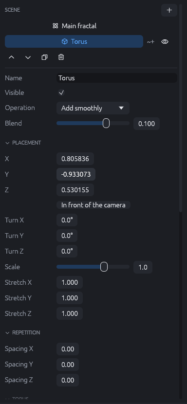
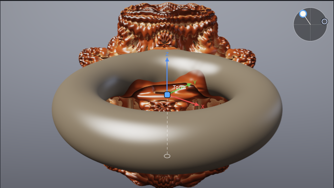
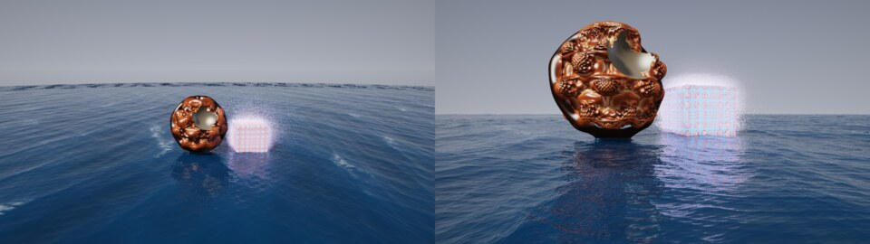
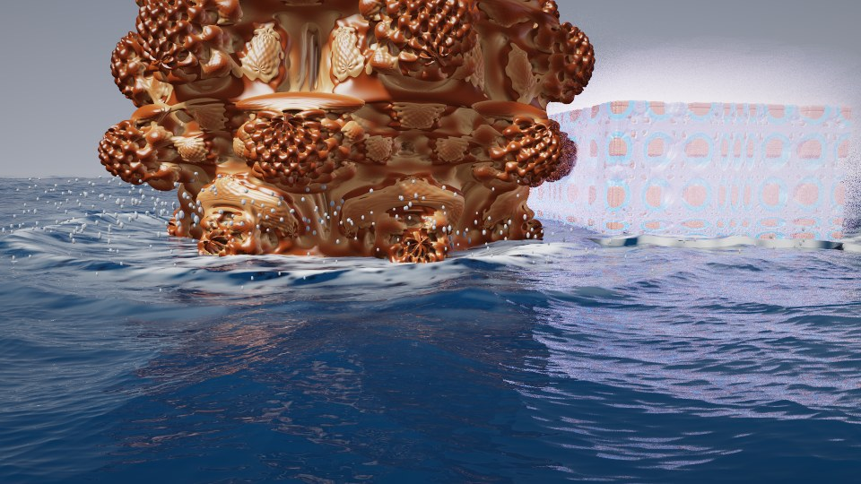
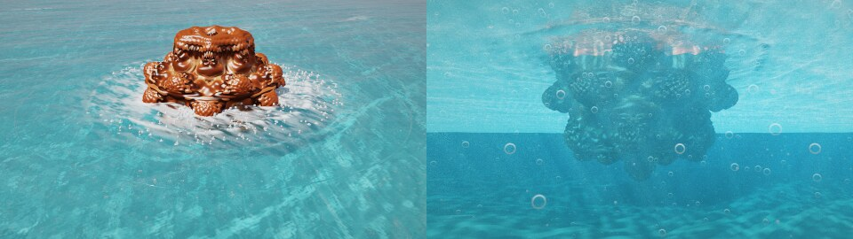
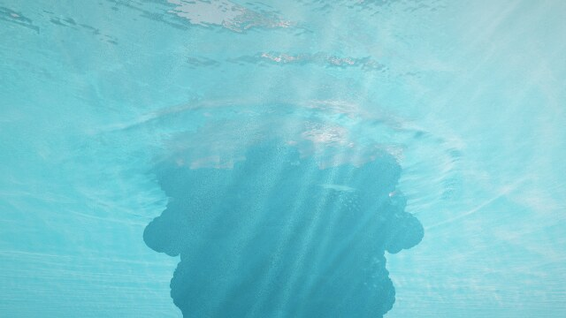
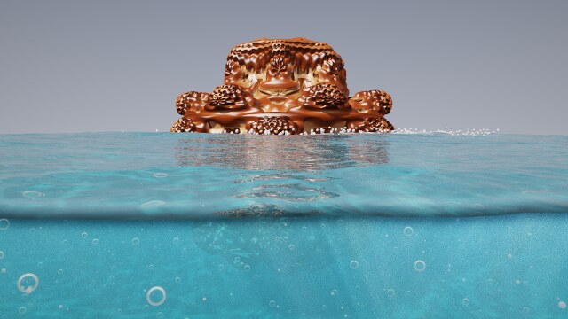

# Scene composition

A scene can hold more than the main fractal: further fractals, basic shapes such as a ground
plane, boxes and spheres, a water surface, and 3D models from other programs. Each of these
**objects** has its own placement and colors, and is combined with the rest of the scene: added
to it, cut away from it or intersected with it, also with smooth blends. This works like
Mandelbulber's "boolean mode", the technique behind many architectural fractal scenes.

## The scene list

The **SCENE** list at the top of the scene panel shows the **Main fractal** and, below it, up to
eight objects. Each object row shows:

- an icon for its kind (fractal, basic shape or 3D model) and its name;
- a sign for its operation: `+` add, `−` cut away, `∩` intersect, `~+`, `~−`, `~∩` for the
  smooth variants;
- an eye button to show or hide the object. Hidden objects are dimmed.

Click a row to edit the object; its settings replace the formulas in the panel below. Click
**Main fractal** to return to the fractal's formulas. In the view, <kbd>Ctrl</kbd>+click selects
the object under the pointer.

With an object selected, the buttons below the list move it up or down, duplicate it or remove
it.

### The order matters

The objects are combined in list order: each one is added to, cut away from or intersected
with **everything above it** in the list. A box that cuts a window into a wall must come after
the wall; a sphere added after that fills the window again.

## Adding objects

The **+** button next to the SCENE title opens a menu:

| Entry | What it adds |
|-------|--------------|
| Fractal | Another fractal with its own formulas, placement and colors. It starts as a small Amazing Box. |
| Plane | A ground: everything below it is solid. Turn it for walls. It starts below the scene with a checker pattern. |
| Box, Sphere, Cylinder, Capsule, Cone, Torus, Hexagonal prism, Triangular prism | Basic shapes. |
| Water | An ocean surface: waves with foam that reflect the sky and the scene, break on the other objects with foam and spray, and move in animations. You can see into it and dive below it. |
| Seabed | An ocean floor: rolling hills and sand ripples. Added with water in the scene, it goes 1.5 units below the water. |
| 3D model… | A model file: OBJ (with its MTL materials), STL, PLY, glTF/GLB or FBX. |

New objects appear in front of the camera (the plane and the water below the scene). The
menu is disabled once the scene has eight objects.

## Object settings

| Setting | What it does |
|---------|--------------|
| Name | The name in the scene list. |
| Visible | Includes the object in the scene. |
| Operation | How the object is combined with everything above it (see below). |
| Blend | For the smooth operations: the distance over which the object melts into the others, in world units. Default 0.1. |

### Operations

| Operation | Result |
|-----------|--------|
| Add | The object joins the scene. |
| Cut away | The object is cut out of everything before it. |
| Intersect | Only what is inside both the object and everything before it remains. |
| Add smoothly | Like Add, with a rounded, melted seam. |
| Cut away smoothly | Like Cut away, with rounded edges at the cut. |
| Intersect smoothly | Like Intersect, with rounded edges. |

!!! tip
    A large sphere set to **Intersect** keeps only a ball-shaped piece of the fractal. A box set
    to **Cut away** opens the fractal like a cross section.

## Placement and gizmos

The **Placement** section of an object:

| Setting | What it does |
|---------|--------------|
| X, Y, Z | Position along the world axes. **In front of the camera** moves the object to the middle of the view. |
| Turn X, Y, Z | Rotation in degrees, about x, then y, then z. A double-click sets 0. |
| Scale | Size as a whole. |
| Stretch X, Y, Z | Extra size along the object's own axes (1: none). A double-click sets 1. |

The selected object also has **handles** in the view. **Move**, **Rotate** and **Scale** in the
top bar choose which:

| Mode | Handles |
|------|---------|
| Move | Arrows along the world axes; drag one to move along it. Drag the center square to move in the plane facing the camera; with <kbd>Shift</kbd> toward or away from the camera. |
| Rotate | Rings about the object's own axes; drag around the center to turn. |
| Scale | Handles on the object's own axes stretch it along that axis. Drag the center to scale it as a whole: right or up makes it larger, left or down smaller. |

While you drag, a small label shows the values. The main fractal is placed with numbers only,
in its own **Placement** section (chapter 5).

## Repetition

The **Repetition** section turns an object into a grid of copies:

| Setting | What it does |
|---------|--------------|
| Spacing X, Y, Z | Distance between the copies along the object's own axes, in its own units (before the scale). 0: no copies along that axis. |
| × (next to a spacing) | Copies on each side of the original. 0: endless. |

Keep the spacing larger than the object, or the copies cut into each other. Endless repetition
of a box or a column gives whole cities or forests at the cost of a single object.

## Shapes

Each basic shape has a section with its size, measured before the object's scale. Shapes
stand upright along their own z axis.

| Shape | Settings |
|-------|----------|
| Plane | None: everything below it is solid. |
| Box | Width, Depth, Height, Rounding (radius of the rounded edges) |
| Sphere | Radius |
| Cylinder | Radius, Height, Rounding |
| Capsule | Radius, Height (from end to end, the round ends included) |
| Cone | Bottom radius, Top radius (0: pointed), Height |
| Torus | Ring radius, Thickness (radius of the tube) |
| Hexagonal prism | Radius (from the axis to the middle of a side), Height |
| Triangular prism | Side, Height |
| Water | See below. |
| Seabed | Hills (height of the hills), Hill size (how far apart the largest are), Ripples (height of the sand ripples), Ripple length (their distance), Ripple direction (degrees; match the water's wave direction). Colored by height: lighter ripple crests. |

### Water

The water is an ocean surface made of many waves, from long swells down to small ripples.
They run around the wind direction (small ones spread wider), long waves faster than short
ones as on the sea, and their crests are pulled sharp. Over large distances the crests bend
and the sea gets calmer and rougher in turns, so a wide view does not repeat. It reflects the sky and the scene by itself, like real water: little when you look
straight down, almost a mirror at grazing angles. The material's **Reflection** (Color tab)
is not needed for it, and the rest of the scene keeps its own setting.

| Setting | What it does | Start value |
|---------|--------------|-------------|
| Wave height | Height of the largest waves. | 0.08 |
| Wave length | Length of the largest waves (across the wind a bit shorter). | 2 |
| Choppiness | Shape of the crests: 0 = round swell, 1 = like the sea, 2 = very choppy. | 1 |
| Detail | Number of waves (4–64), from long swells to small ripples: more give a richer sea and cost speed. | 32 |
| Direction | Wind direction in degrees; the waves run mostly along it. | 0 |
| Foam | White, broken foam on the highest crests, streaked along the wind. | 0.3 |
| Shore waves | Waves running in toward the other objects and breaking on them, with foam along the coast (0 = none, 2 = strong surf). | 1 |
| Spray | Drops splashing up where the waves break and flying in arcs (0 = none, 2 = high, wide splashes; needs shore waves). | 1 |
| Drop size | Size of the spray drops (0.2–3; larger drops are fewer). | 1 |
| Drop size variation | How much the drop sizes differ: 0 = all alike, 1 = from tiny to full size. | 0.5 |
| Reflection | How strongly the water reflects (1 = like water, 2 = twice as much). | 1 |
| Speed | How fast the waves move in animations (per second; 0 = still). Long waves run faster than ripples. | 1 |
| Time | The moment of the waves: another value shows another wave pattern in a still image. Animations add the speed per second to it. | 0 |

Opaque water (**See-through** off, see below) takes the color of its body from its own colors
(its material): it gets brighter on the crests, where the light shines through the waves.
Dark blue-green colors look like deep sea; lighter, greener ones like shallow water.
See-through water gets its color from the **Underwater** settings instead and uses the
material only for the foam's highlights. The sun shows as sharp glints on the waves.
The water looks best under a bright sky: it reflects the background (chapter 12), so a blue
sky gradient and a low light give the contrast of open sea.

#### Waves on the shore

The water knows how far every point of it is from the rest of the scene: fractals, other
primitives and models. Near them, shore waves run in toward the coast, growing shorter,
steeper and higher, and collapse into foam right at it; a belt of foam lines the coast. Each
time a wave reaches the coast, drops splash up and fly in arcs: up, sideways and back down.
Their direction comes from slow noise around the wind direction, so nearby drops fly
together while their heights, sizes and moments stay random. Everything moves with the
waves in animations. Objects just below the surface count as shallows: the waves break over
them too.

!!! note
    The water is the last object combined into the scene, whatever its place in the list,
    so it sees all others. The surf reaches out about half a wave length; a fractal's
    distance estimate is often smaller than the real distance, so around fractals it can
    reach a bit farther. Shore waves and spray cost some speed near the coast.

#### Under water

New water is **see-through**: rays bend into it at the surface (refraction) and the camera can
dive below it. Everything in the water fades into the water's color with distance, red
first, then green, as in real water; light from above gets weaker and bluer with depth, so
deep parts of a fractal turn dark blue-green. From below, the sky shows through a bright
circle above the camera (Snell's window); beyond it the surface is a mirror that reflects
the depths (total internal reflection). Shadows and occlusion pass through the water; the
light that reaches a point under it is weakened by the way it travels through the water.

The waves focus the sunlight into **caustics**: bright, moving lines on everything under
the water (fractals, objects, the ground). They come from the real waves, so they move with
them in animations and grow coarser and softer with depth. The same light, scattered by the
water, shows as **light rays**: shafts that come down from the waves, cut by the shadows of
the objects in the water. They are brightest when you look toward the light.

Air **bubbles** rise through the water: clear spheres with a bright rim (where the water
reflects all light back) and the sun as a glint. Tiny **particles** float in it and catch the
light. Both move in animations.

With the camera right at the surface, the waterline crosses the camera's front glass (**Lens
size**): the picture splits into the view above and below the water, along the waves, with a
dark line where the water clings to the glass. The waves move the line up and down in
animations.

The **Underwater** section of the water object holds the settings:

| Setting | What it does | Start value |
|---------|--------------|-------------|
| See-through | Rays pass through the surface, the camera can dive. Off: opaque, reflecting water (scenes from older versions). | on |
| Refraction index | How much rays bend at the surface (water 1.33; 1 = not at all). | 1.33 |
| Water color | Color of deep water near the surface: what distant things fade into. | dark blue-green |
| Filter color | Color white light keeps after the visibility distance: darker channels fade faster. | red low, blue high |
| Visibility | Distance (scene units) after which light is filtered down to the filter color. | 3 |
| Murkiness | Fading of all colors alike, like floating particles (0 = clear, 1 = murky). | 0.25 |
| Depth darkening | How much the light from above weakens with depth (0 = equally bright at every depth). | 1 |
| Caustics | Light focused by the waves into moving bright lines on everything under the water (0 = none, 1 = natural, 2 = strong). Also shapes the light rays. | 1 |
| Caustic sharpness | 0 = soft, wide patches; 1 = fine, sharp lines. | 0.5 |
| Light rays | Sunlight scattered in the water: shafts from the waves and the shadows of objects, brightest looking toward the light (0 = none). | 0.4 |
| Bubbles | Air bubbles rising in the water (0 = none, 1 = many). | 0.2 |
| Bubble size | Size of the largest bubbles (scene units). | 0.012 |
| Bubble speed | How fast the bubbles rise in animations (units per second). | 0.25 |
| Particles | Tiny floating particles that catch the light (0 = none, 1 = many). | 0.15 |
| Particle size | Size of the particles (scene units). | 0.0025 |
| Time | The moment of the bubbles and particles; animations add one per second. | 0 |
| Lens size | Size of the camera's front glass: with the camera at the surface the picture splits into the views above and below the water (0 = no split). | 0.2 |

!!! note
    Only the first see-through water of a scene is a medium you can dive into; further
    water objects are surfaces. The depth is measured from the open sea's surface, without
    the shore waves. **Bounces** in the Color tab sets how many reflections and passes
    through the surface a ray follows (default 2).

!!! note
    Caustics and light rays come from directional lights and lights above the water; a
    light under the water lights its surroundings without them. Light rays cost a shadow
    ray per sample, and need more samples than the rest of the image to get smooth.

!!! tip
    For a scale to start from: the visibility is the distance at which the red of an
    object is almost gone. A visibility of a few times the fractal's size gives clear
    tropical water; less than its size gives a murky lake.

## Fractal objects

A fractal object has the same hybrid chain, formula parameters, **Iteration** settings and
**Two chains** (DE combination and interpolation) as the main fractal (chapter 5). It does not
have the slot settings, **Inside**, the 4D rotation, **Min iterations** or the **C factor**. The
formula editor works on the selected slot of the fractal you are editing.

## Materials

The **Material** section of an object:

- **Own colors** off: the object uses the main fractal's colors (Color tab).
- **Own colors** on: the object gets its own gradient, glow bands, mapping and texture layers.
  The gradient and texture layers work like those of the main fractal (chapter 11).

| Setting | What it does |
|---------|--------------|
| Pattern | Shapes and models: how the colors are picked from the gradient. **Solid** (one color, picked by **Offset**), **Checker** (alternating squares in the gradient's end colors), **By height**, **From the center**. Models also have **Model colors**: the colors and textures of the model file. |
| Pattern size | Size of the checker cells, or the height or distance per gradient length. |
| Color by | Fractals: which value of the orbit picks the color, as in the Color tab. |
| Scale, Offset | How fast the colors change, and where the gradient starts. |
| Rotation | In animations: the gradient turns by this many gradient lengths per second. |
| Repeat | Repeats the gradient instead of holding its end colors. |

## 3D models

A 3D model is turned into a distance field, so the renderer can treat it like any other
object. This **baking** runs in the background when you add the model; a progress bar shows it,
and the model appears when it is done. The section **3D model** then shows the number of
triangles, materials and grid points.

| Setting | What it does | Default |
|---------|--------------|---------|
| Change… | Picks another model file. | |
| Resolution | Grid points along the longest side of the distance grid (64, 96, 128, 192, 256). Higher renders faster near complex models, but bakes longer and needs more memory (256: about 32 MB). | 128 |
| Up axis | Which axis of the file points up. Auto: Y for glTF and OBJ (Blender's export default), Z for STL and PLY. | Auto |
| Keep file units | Off: the model is centered and sized to 2 units, then scaled by the placement. On: the file's own coordinates. | off |

The grid is used away from the model; near its surface the triangles themselves are used, so
thin parts and fine detail stay sharp at any distance.

### Model materials

The **Materials** section lists the materials of the model file. For each one:

- the **color button** sets the base color (a right-click returns to the file's color);
- the **texture menu** picks the color texture: the one from the model file, none, an image
  found near the model, or any image (**Browse…**);
- clicking the **name** opens more maps: **Bump** (a height map, with **Strength**),
  **Specular** (bright parts shine, dark parts stay matte), **Normal map** (with **Normal
  strength**) and **Emission** (the material shines by itself, with **Emission color** and
  **Emission strength**).

Names in bold were changed here; a layers icon marks materials with maps or emission. The
changes are saved with the scene; the model file stays untouched.

Above the list:

| Control | What it does |
|---------|--------------|
| Filter | Shows only the materials whose name contains this text. |
| Auto-assign | Assigns the images near the model file to the materials by name (replaces the image choices, keeps the colors). |
| Rescan | Looks for images near the model again. |
| Reset | Uses the materials exactly as the model file has them. |
| Color all shown | Gives every material in the (filtered) list the color of the button next to it. |

"Near the model" means: in the model's folder, in the folders inside it (two levels deep) and in
a `textures` folder next to the model's folder. When a model is added, RMandelbulb3D runs
**Auto-assign** once by itself. glTF and FBX files bring their normal maps and emission along,
OBJ files their emission (`Ke`).

### The model cache

Baked distance grids are kept on disk, in `rmandelbulb/models/` of your cache folder
(`~/.cache` on Linux). The next time you open a scene with the same model and settings, it loads
without baking. The oldest files are removed when the cache grows beyond about 2 GB. The
environment variable `RMB_MODEL_CACHE` sets another folder; `off` switches the cache off.

!!! note
    A lower **Resolution** bakes faster and needs less memory, but renders slower near the
    model.
