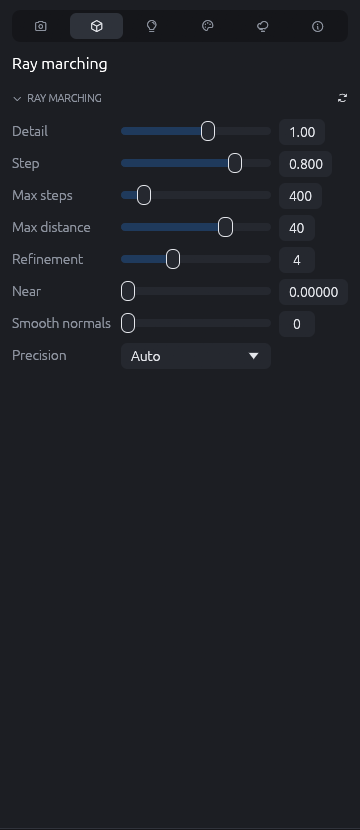

# Ray marching

RMandelbulb3D draws a fractal by *ray marching*: for every pixel a ray leaves the camera and
moves toward the fractal in steps. At each step the formula tells how far away the surface is
at most (the *distance estimate*), and the ray jumps ahead by about that much. When the
remaining distance gets smaller than a threshold, the ray has hit the surface.

The **Ray marching** tab (the cube icon in the inspector) holds the settings of this process.
They decide how fine the surface is, whether thin parts survive, and how long a pass takes.

The ↻ button next to the section title puts all settings back to their defaults. As
everywhere in the program, a double-click on a single slider resets just that slider.

## Settings

| Setting | What it does | Range / default |
|---------|--------------|-----------------|
| **Detail** | The surface threshold in pixels (Mandelbulb3D's *DEstop*). A ray counts as a hit when it comes closer to the surface than this. Smaller values give finer detail, but cost time. | 0.05–8, default 1 |
| **Step** | Multiplies every step of the ray. Lower it against holes and noise caused by overstepping. | 0.05–1, default 0.8 |
| **Step limit** | Largest ray step, in half widths of the view at that distance (Mandelbulb3D's ray step limiter; 0 = no limit). See below. | 0–4, default 0 |
| **Step minus detail** | Every camera ray step is the estimate minus most of the threshold, with a step factor closer to 1 (Mandelbulb3D's "step sub DEstop"): more, shorter steps near the surface. | off |
| **Max steps** | Steps per ray before it gives up. | 50–3000, default 400 |
| **Max distance** | Rays end after this distance from the camera. | 0.01–1000, default 40 |
| **Refinement** | Binary search steps at the surface for an exact hit. | 0–12, default 4 |
| **Near** | Rays start at this distance from the camera, so everything closer is hidden. Mandelbulb3D imports set it. | 0–10, default 0 |
| **Smooth normals** | Averages the surface direction along the surface (steps to each side; 0 = off) and measures the roughness for the lighting. | 0–8, default 0 |
| **Precision** | Number precision of the GPU renderer: *Auto*, *Single* or *Double* (see below). | default *Auto* |

### Detail

Detail is measured in pixels of the image, not in world units. A detail of 1 means: stop when
the surface is closer than about one pixel. Two things follow from this:

- When you zoom in, the threshold shrinks with the view, so you see more and more structure.
  You never have to adjust it while exploring.
- A larger image has smaller pixels, so the same setting shows finer detail at 4K than in the
  preview. The colors may shift slightly between sizes when the coloring depends on the
  iteration count at the hit (see **Detail shift** in chapter "Color").

Values below 1 bring out tiny filaments and dust; values above 1 smooth the surface and render
faster, which is handy for quick tests.

### Step

The distance estimate of many formulas is only an approximation. When it overestimates, the ray
jumps *into* the fractal and either misses thin parts or lands somewhere inside. The symptoms
are holes, speckled noise or flat "stripes" on the surface.

- Lower **Step** until the problem disappears. 0.5 is a good first try; some Mandelbulb3D
  formulas need 0.2–0.3.
- Every halving of the step roughly doubles the number of steps per ray, so raise **Max steps**
  when parts far away start to vanish.

### Step limit

Some estimates are far too large away from the fractal (hybrids of very different formulas,
Mandelbulb3D's dIFS "mix"). A single step can then jump past the whole fractal, so it appears
tiny or partly missing, or deep into it, which shows as dark speckles. **Step limit** caps every
step at a share of the view's width at that distance from the camera, and with a limit the estimate may also
grow by at most the last step from one step to the next. Mandelbulb3D always marches like
this, so its imports set the limit (from its ray step limiter, the step and DEstop); 0.3–1 is
a good range to try on your own scenes.

### Max steps and Max distance

A ray that has used up **Max steps** or flown farther than **Max distance** shows the
background. If distant parts of the fractal are missing or fade into the background too early,
raise one of the two. Raising them costs little for rays that hit something early, but rays that
pass close to the fractal without hitting it run longer.

**Max distance** also defines the far end of the view range that the *Range* fog uses (chapter
"Effects").

### Refinement

When a ray reaches the surface threshold, a binary search moves the hit point onto the surface.
More refinement steps give a cleaner surface position, which matters for sharp shadows and
highlights. The search stops early as soon as it is precise enough, so the maximum rarely costs
the full amount. 0 switches it off.

When the hit point is still inside the fractal (a point that did not escape within the
iteration limit), the search continues past this value until it reaches the surface. Without
that, such points get no usable normal and show up as black flakes or bands close to the
surface.

!!! tip
    Black flakes that remain when you fly very close usually mean the iteration limit is too
    low for that distance: the fractal's detail ends there. Raise **Max iterations**.

### Near

Rays start at this distance in front of the camera, so everything between the camera and that
distance is cut away. Use it to look past a wall that is in the way, or to cut into a structure
in front of you. Imported Mandelbulb3D scenes often bring a value along.

### Smooth normals

The surface direction (the *normal*) decides how light falls on each point. On very detailed
fractals it changes from pixel to pixel, which can look grainy. **Smooth normals** averages it
over a few steps along the surface (Mandelbulb3D's smoothed normals).

It also measures how rough each spot is. The **Roughness** setting in the Lighting tab uses this
measure to dull the highlights on rough parts; it has no effect while Smooth normals is 0.

Every step costs more distance estimates per pixel, so use small values (1–3) first.

## Precision and deep zooms

The graphics card normally computes with *single precision* numbers (about seven digits). That
holds up to a zoom of about 10,000. Beyond that the surface gets grainy and blocky, because the
numbers can no longer tell neighboring points apart.

| Precision | What it does |
|-----------|--------------|
| **Auto** | Single precision while it suffices, double precision when the zoom needs it (it switches at a zoom of about 5,000). |
| **Single** | Always single precision: fastest. |
| **Double** | Always double precision: two numbers per value, about 14 digits, for deep zooms to about 1e11. |

Double precision has its costs:

- It renders several times slower. Formulas with sine and cosine (such as the Mandelbulb) are
  about 25 times slower; box formulas suffer less.
- Switching compiles the shader again. The first time this takes 10–20 seconds; the graphics
  driver keeps the result, so later switches are quicker.
- Only the main fractal is computed in double precision. Objects added in the scene
  composition (chapter "Scene composition") stay in single precision.

The CPU renderer of the command line program (`rmb-cli render --cpu`) always computes in double
precision. Zooms deeper than about 1e11 need it.

!!! tip
    Leave Precision on *Auto*. Pick *Single* if you are only slightly past the switch point and
    the image still looks clean, to keep the speed.

## Quality against speed

The time of a pass is spent mostly at the surface: refining the hit, measuring the normal and
tracing the first steps of shadow and occlusion rays. Points far from the fractal are cheap.

| To get… | Change | Cost |
|---------|--------|------|
| Finer detail | Lower **Detail** | More steps near the surface, more distant detail to resolve |
| Fewer holes and less noise | Lower **Step**, raise **Max steps** | Roughly proportional to 1 / Step |
| More of the distance | Raise **Max distance** and **Max steps** | Only rays that do not hit early |
| Cleaner shading | **Smooth normals** 1–3 | Extra estimates per pixel |
| Sharper hit positions | Raise **Refinement** | Small; stops early when precise |
| Deep zooms | **Precision** *Double* | Several times slower |

!!! note
    Moving these sliders never makes the preview wait for a new shader; it updates at once.
    Only switching the Precision compiles a shader.
