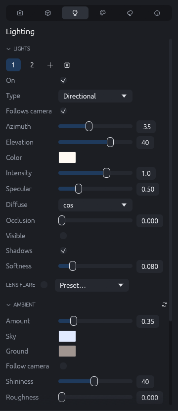

# Lighting

The **Lighting** tab (the light bulb icon) holds the lights of the scene with their shadows,
glows and lens flares, the ambient light, global illumination and ambient occlusion.

## Lights

A scene has up to **eight lights**. The numbered buttons at the top select a light (the number
of a switched-off light is grayed). **+** adds a light, the trash icon removes the selected one.
A new scene starts with two directional lights: a warm main light with shadows and a weak blue
fill light without.

With the **Sky** background and **Sun lights the scene** (Effects › Background), light 1
follows the sky's sun: its direction, color and intensity come from the sky, and so do the
ambient sky and ground colors; the ambient **Amount** then scales the sky's light (notes above
the settings say so). With clouds in the sky, they shade light 1 (moving cloud shadows) and
the ambient colors are the sky's light seen through them.

With **Lights** switched on in the top bar, the lights are drawn in the view with handles:
click one to select it, drag it to move or aim it. Clicking a light in the view also opens
this tab with that light selected.

### Light types

| Type | What it is |
|------|------------|
| **Directional** | Parallel light from a direction, like the sun. |
| **Point** | Light from a position. It falls off with the squared distance. |
| **Spot** | A point light that shines into a cone. |
| **Area** | A glowing rectangle. Gives soft shadows. |
| **Line** | A glowing tube between two points. Gives soft shadows. |

### Settings of a light

| Setting | What it does | Range / default |
|---------|--------------|-----------------|
| **On** | Switches the light on or off. | |
| **Type** | See the table above. | Directional |
| **Follows camera** | *Directional only.* The direction is relative to the view, so the light moves with the camera. Off: fixed in the world. | on |
| **Azimuth** | *Directional only.* Horizontal direction in degrees (0 = from the camera, or from +x when fixed in the world). | −180–180 |
| **Elevation** | *Directional only.* Height above the horizon in degrees. | −90–90 |
| **X**, **Y**, **Z** | *Positional lights.* The position in the world (for a line light: its start). | |
| **Aim X/Y/Z** | *Spot and area lights.* The point the light faces. | |
| **End X/Y/Z** | *Line lights.* The other end of the line. | |
| **Cone angle** | *Spot.* Half angle of the cone in degrees. | 0.5–90, default 25 |
| **Cone edge** | *Spot.* How soft the edge of the cone is (0 = sharp, 1 = fades from the center). | 0–1, default 0.3 |
| **Width**, **Height** | *Area.* Size of the rectangle in world units; larger gives softer shadows. | default 0.5 |
| **Color** | The light color. | |
| **Intensity** | Brightness (point lights: at distance 1). | 0–1000 |
| **Specular** | Strength of the highlights of this light. | 0–2, default 0.5 |
| **Diffuse** | How the light falls off with the angle to the surface: *cos*, *cos²* (harder), *Wrap* and *Wrap²* (also light the back sides). These are Mandelbulb3D's diffuse functions. | cos |
| **Occlusion** | How much the ambient occlusion darkens this light. | 0–1, default 0 |
| **Visible** | The light source itself shows in the image as a glow (below). | off |
| **Shadows** | Casts shadows. Costs one shadow ray per sample. | on |
| **Softness** | Width of the shadow edges (0 = hard). Not shown for area and line lights, which get their softness from their size. | 0–0.5, default 0.08 |

Two buttons help to place positional lights:

- **At camera** moves the light to the camera. Spot and area lights then shine along the view.
- **Aim at view center** aims the light at the surface point in the middle of the view. For a
  line light the button reads **Center on view** and moves the whole line (same length and
  direction) over that point.

!!! tip
    Area and line lights are sampled at a new point on every pass, so their soft shadows refine
    with the samples: give them enough samples in the final render.

### Visible lights

With **Visible** on, the light shows as a glow in the image, hidden by the fractal in front of
it and dimmed by the depth fog. Area lights show as their glowing rectangle; only **Glow
intensity** applies to them. The other types have:

| Setting | What it does |
|---------|--------------|
| **Glow shape** | *Soft*: bright core with a soft falloff. *Sharp*: a small spot. *Ball*: a glowing ball that covers what is behind it. *Halo*: a transparent halo. |
| **Glow size** | The glow radius: in degrees for directional lights (which show on the background only), in world units for point and spot lights, the tube radius for line lights. |
| **Glow intensity** | Brightness of the glow. Smaller glows are brighter, like in Mandelbulb3D. |

## Lens flares

Every light can have a lens flare: the reflections and diffraction a camera lens adds around a
bright light. Switch it on with the check box next to **LENS FLARE**. The flare is shown when the
light is in or near the view; it fades when the fractal hides the light, in depth fog and when the
light leaves the image. Sizes are given as a share of the image height, so a flare looks the same
at any resolution.

**Preset…** replaces all flare settings with a ready-made look: *Classic*, *Anamorphic*, *Sun*,
*Star*, *Spike ball*, *Sci-fi*, *Subtle* and *Dirty lens*. Start from a preset and adjust it.

The general settings are **Intensity** (brightness of the whole flare), **Tint** (multiplies the
light's color) and **Variation**, the seed of the random parts (spikes, ghosts, sparkles, dirt).
**Shuffle** picks another random arrangement.

The parts of the flare sit in collapsible groups:

| Group | Settings |
|-------|----------|
| **Glow** | **Core** and **Core size**: the bright center. **Haze** and **Haze size**: a wide soft glow that lifts the dark parts. |
| **Star and spikes** | **Star rays** (0 = none; even counts look like real apertures), **Ray brightness**, **Ray length**, **Ray width**, **Rotation**, **Uneven** (varies length, brightness and angle), **Spikes** (fine random spikes), **Spike brightness**, **Spike length**. |
| **Anamorphic streak** | **Streak** (brightness, 0 = none), **Length**, **Width**, **Color** (blue is the classic look), **Angle** (0 = horizontal), **Sparkles** (dots along the streak), **Sparkle brightness**. |
| **Ghosts** | Reflections of the aperture on the line from the light through the image center: **Ghosts** (number), **Brightness**, **Size**, **Spread**, **Blades** (ghost shape; 0 = round), **Softness**, **Rings** (share of hollow ghosts), **Coating colors** (0: the light's color, 1: varied lens coating tints), **Color fringes**. |
| **Ring** | A halo ring around the light: **Ring** (brightness), **Radius**, **Width**, **Rainbow** (0: the light's color, 1: rainbow colors). |
| **Lens dirt** | Dust and smudges that light up near the light: **Dirt** (brightness, 0 = clean lens) and **Reach**. |

### Hand-placed ghosts and bokeh

Normally the ghosts come from the seed and the sliders. **Place ghosts by hand** copies them into
a list you can edit one by one. Each row has:

- a color swatch: the lens coating tint (mixed with the light's color by **Coating colors**);
- **at**: the position on the line from the light (0) through the image center (1) and beyond;
- **size**: the radius as a share of the image height;
- **×**: the brightness, times the ghost brightness above;
- a check box: a hollow ring instead of a disc;
- the trash icon removes the ghost.

**Add** appends a ghost; **Use generated** throws the list away and returns to the generated
ghosts.

**Bokeh…** picks an image whose brightness shapes every ghost, for example a bokeh texture with
dust or an odd aperture. Without an image, the aperture blades shape the ghosts.

!!! note
    Lens flares are drawn on top of the rendered image, after the denoiser and before bloom and
    the Image settings (chapter "Image"). They show in the preview, the render window and every
    export.

## Ambient

Ambient light is the light that comes from the surroundings rather than from a light source.

| Setting | What it does | Range / default |
|---------|--------------|-----------------|
| **Amount** | Strength of the light from the surroundings. | 0–2, default 0.35 |
| **Sky** | Ambient color from above (+z, or the top of the screen). | light blue |
| **Ground** | Ambient color from below. | dark brown |
| **Follow camera** | Sky and ground follow the camera's up axis instead of the world z axis (as in Mandelbulb3D). | off |
| **Shininess** | Size of the highlights: higher is smaller and sharper. | 2–1024, default 40 |
| **Roughness** | How much rough surface parts lose their highlights and get softer light. Needs **Smooth normals** in the Ray marching tab. | 0–1, default 0 |

With a background image and its **Ambient light** option on (Effects › Background), a blurred
copy of the image replaces the sky and ground colors; the tab then says "from the background
image".

## Ambient occlusion

Ambient occlusion darkens creases, holes and places where the fractal shades itself. Choose a mode:

- **Off**: no ambient occlusion.
- **Fast**: five distance samples along the surface normal. No noise, cheap, but less realistic.
- **Ray traced** (default): random rays into the hemisphere above each point. Realistic; it is
  noisy at first and refines with the samples.

| Setting | What it does | Range / default |
|---------|--------------|-----------------|
| **Strength** | How dark occluded areas get. Above 1 the darkening gets steeper (as in Mandelbulb3D). | 0–4, default 0.9 |
| **Radius** | Reach of the occlusion, relative to the view distance. | 0.002–2, default 0.08 |

Ray traced occlusion is one of the most expensive parts of a pass. If a preview is too slow,
*Fast* is a good temporary choice.

## Global illumination

This section chooses how the light is computed:

- **Classic** (default): lights with shadows, ambient light with occlusion and the light rays of
  emissive colors, in the style of Mandelbulb3D. Fast.
- **Path tracing**: Monte Carlo path tracing. Light bounces between the surfaces (diffuse and
  reflections), glowing colors light everything around them, and the ambient colors become the
  light of the sky. More realistic, but it needs more samples; use the denoiser.

Path tracing has two settings:

| Setting | What it does | Range / default |
|---------|--------------|-----------------|
| **Bounces** | How often light bounces at most. More bounces give brighter, softer indirect light and cost more per sample. | 1–16, default 4 |
| **Firefly clamp** | Limits the light a single bounce adds. Removes lone bright pixels at the cost of a little light (0 = off). | 0–100, default 10 |
| **Sky reach** | Diffuse bounces that travel farther than this, relative to the surface's distance from the camera, count as open sky. Like Mandelbulb3D's Monte Carlo renderer with its short ambient rays: brighter crevices and halls, less realistic. 0 lets light bounce as far as it goes (physically correct). | 0–0.5, default 0 |

In path tracing, ambient occlusion and the emission light rays are not used: the bounces bring
that light. While you move the view, the preview is shaded classically.

!!! tip
    Path traced images need many more samples than classic ones to get clean. Switch on
    **Denoise** (Effects › Image) for the final render.
