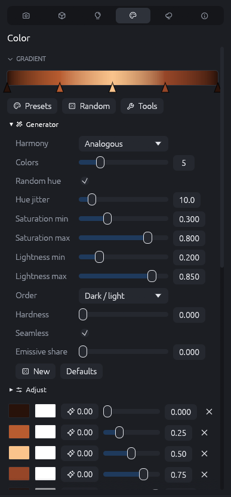
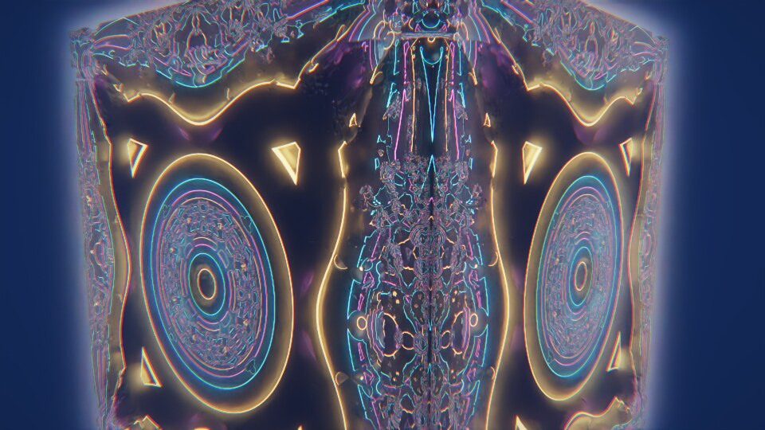
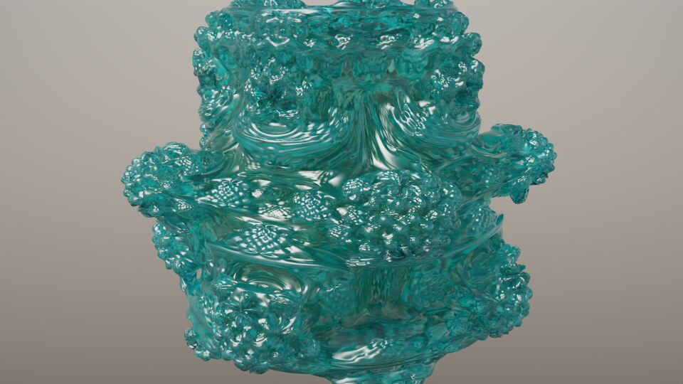

# Color

The **Color** tab (the palette icon) decides how the surface looks: the gradient of colors, glow
bands, how the gradient is laid onto the fractal, shine, reflections and glass, glowing colors,
texture layers and a color map. Objects of the scene composition have the same settings in their
own material (chapter "Scene composition").

## Gradient

The surface takes its colors from a **gradient**: a strip of colors defined by *stops* (colors
at positions between 0 and 1). The fractal picks a position on it for every point, by the value
chosen under **Mapping › Color by**. A new scene uses the *Copper* gradient.

### Editing the strip

- **Drag** a marker below the strip to move its color.
- **Click** the strip to add a color there (it takes the color the gradient already has there).
- **Right-click** or **double-click** a marker to remove it. At least two colors stay.
- A thin white line above the strip marks emissive (glowing) parts.

Below the strip, every stop has a row, sorted by position:

| Control | What it does |
|---------|--------------|
| First swatch | The surface color. |
| Second swatch | The highlight color: multiplies the specular light at this color. |
| Transparency | *Only with Glass on.* 0 = opaque, 1 = clear. |
| ✦ field | **Emission**: this color shines by itself, lights its surroundings and glows (0 = off). |
| Slider | The position on the gradient. |
| × | Removes the color. |

**Add color** adds a color in the middle of the gradient.

### Presets, Random and Tools

- **Presets** lists the built-in gradients (Copper, Ice, Bone, Jade, Lava, Gold, Spectrum,
  Slate, White) and, under *SAVED*, your own palettes. Click one to replace the colors. To save
  the current colors, type a **Name** and click **Save**; a saved palette with the same name is
  replaced. The trash icon deletes a saved palette. Saved palettes are kept in `palettes.json`
  in the configuration folder (chapter "Reference").
- **Random** makes a new random palette with the settings of the **Generator**.
- **Tools** changes the whole palette at once:

| Tool | Effect |
|------|--------|
| Reverse | The gradient runs the other way. |
| Shift by a quarter | Moves all colors a quarter along the gradient, wrapping around. |
| Mirror | Squeezes the gradient into the first half and mirrors it into the second: repeats without a seam. |
| Repeat twice | The gradient twice over the same length. |
| Space evenly | Spreads the colors evenly in their order. |
| Sort by lightness | Orders the colors from dark to light and spaces them evenly. |
| Invert lightness | Dark colors become light and light ones dark; hue and saturation stay. |
| Hard steps | Each color becomes a solid band. |
| Smooth blends | One stop per color, blending smoothly, spaced evenly. |

### Generator

The **Generator** makes palettes from color harmony rules. Changing a setting makes the palette
again with the same random choices; **New** (or **Random** above) draws new ones. **Defaults**
resets the settings.

| Setting | What it does |
|---------|--------------|
| **Harmony** | How the hues relate: *Random*, *Analogous* (neighboring hues), *Complementary*, *Split complementary*, *Triadic*, *Tetradic*, *Monochrome*, *Dark + neon* (mostly very dark, dull colors with a few bright, saturated ones). |
| **Colors** | Number of colors (2–16, default 5). |
| **Random hue** / **Hue** | Pick the base hue at random, or set it in degrees (0 red, 120 green, 240 blue). |
| **Hue jitter** | Random deviation of every hue from the harmony, in degrees. |
| **Saturation min/max**, **Lightness min/max** | Ranges of the colors (not for Dark + neon). Lightness is perceptual. |
| **Order** | *As generated*, *Dark / light* (alternating), *Dark to light*, *By hue*. |
| **Hardness** | 0: smooth blends, 1: solid bands with hard edges. |
| **Seamless** | The gradient ends with its first color, so repeated gradients have no seam. |
| **Emissive share** | Share of the colors (the brightest first) that glow by themselves. |
| **Emission** | Emission strength of those glowing colors. |

!!! tip
    *Dark + neon* with an **Emissive share** of 0.2–0.4 gives dark structures crossed by glowing
    neon lines.

### Adjust

The **Adjust** sliders change the whole palette relative to the colors when you first touched
them: **Hue** (degrees), **Saturation**, **Lightness**, **Contrast** and **Hardness**. **Apply
and reset** keeps the adjusted colors and puts the sliders back to zero.

## Glow bands

Glow bands are stripes laid over the gradient, independent of its colors. Thin bands with
emission make single glowing lines through the fractal. **+** next to *GLOW BANDS* adds a band;
up to four are drawn.

The strip shows the gradient with its bands; drag a band's marker to move it. Each band has an
on/off check box, a **color**, an **emission** (✦; 0 = a plain color stripe), its **position**,
**Width** (in gradient lengths), **Soft** (0: hard edges, 1: soft from the center) and a
**speed** (gradient lengths per second; animations only, see chapter "Animation").

## Mapping

| Setting | What it does |
|---------|--------------|
| **Color by** | Which value picks the gradient color (see below). |
| **Color on iteration** | Mandelbulb3D's "color on iteration": the colors come from the orbit after this many iterations instead of from where it escaped (0: the start point, off: −1). Main fractal only. |
| **Scale** | How fast the colors change with the value; negative reverses the gradient (−10–10, default 0.15). |
| **Offset** | Shifts the gradient. |
| **Rotation** | *Animation:* the gradient (with its glow bands) turns by this many gradient lengths per second (palette rotation). |
| **Interior colors** | Colors where rays meet the inside of the fractal (cut planes, camera inside). Only shown for scenes imported from Mandelbulb3D; × removes them. |
| **Depth shift** / **Depth reference** | Moves the gradient with the distance from the camera, beyond the reference distance. |
| **Detail shift** | Adds this times the logarithm of the surface threshold to iteration values: keeps colors steady while zooming (Mandelbulb3D). |
| **Repeat** | Repeats the gradient; off: clamps at its ends. |
| **Color amount** | 0: everything in the first gradient color. |
| **Specular** | Shininess of the material, for all lights (0–3, default 1). |
| **Reflection** | Mirror reflections and glass (0 = off). Reflections are weighted by the highlight colors of the gradient. Costs another ray per bounce. |

### Color modes

| Color by | Value |
|----------|-------|
| **Iterations** | The smooth iteration count (default). |
| **Iterations (MB3D)** | The iteration count interpolated like Mandelbulb3D. |
| **Orbit trap** | How close the orbit comes to the origin. |
| **MB3D 2nd choice** | Mandelbulb3D's second color choice, picked under **2nd choice**: *Orbit trap (min. distance to 0)*, *Last length increase* (with an **LLI multiplier**), *Rout angle of X, Y* / *X, Z* / *Y, Z*, *Map on output vector*. |
| **Radius** | The distance of the surface point from the origin. |
| **Normal** | The surface direction. |
| **Position: plane** | The gradient runs through space along a direction, in parallel layers. |
| **Position: sphere** | The gradient runs outward from a center, in spherical shells. |

The position modes have a **Center X/Y/Z** (**Use view center** puts it on the surface point in
the middle of the view) and, for the plane, a **Direction X/Y/Z** (**From camera** uses the
viewing direction). **Scale** then means gradient lengths per world unit. With a glow band,
small scales give one front of light that sweeps through the fractal when animated.

### Reflections and glass

With **Reflection** above 0 more settings appear:

| Setting | What it does |
|---------|--------------|
| **Bounces** | Reflections of reflections; with glass, how many surfaces a ray passes through or reflects from (1–8, default 2). |
| **Gloss** | Blurs reflections and refractions like brushed metal or frosted glass (0 = mirror sharp). Needs more samples. |
| **Glass** | Light passes through the surfaces by the transparency of each gradient color, refracted and absorbed inside. |
| **Refraction index** | *Glass.* 1 = no bending, water 1.33, glass 1.5, diamond 2.4. |
| **Absorption** | *Glass.* Light absorbed per world unit, tinted with the surface color where the ray entered. |
| **Scattering** | *Glass.* Light scattered inside the glass, in the surface color. |

## Emissive colors

Gradient colors, glow bands, *Glow* texture layers and the color map can shine by themselves.
Give one of them an emission and this section offers:

| Setting | What it does |
|---------|--------------|
| **Light** | How much emissive colors light their surroundings in their color (0 = not; costs a ray per sample). |
| **Reach** | How far that light reaches, relative to the distance from the camera. |
| **Rays** | Rays per sample that gather this light (1–8): more give a cleaner image sooner. |
| **Glow** / **Glow size** | A glow around emissive parts, also in the air in front of them. |
| **Steam** | Glowing haze around emissive parts, broken up by 3D noise like steam or smoke (0 = off). |
| **Steam size**, **Steam grain**, **Steam cover** | How far the haze reaches, the size of its clouds (world units) and how much space they fill. |
| **Steam drift X/Y/Z** | *Animation:* the clouds move by this much per second (positive z rises). |
| **Steam offset X/Y/Z** | Moves the cloud pattern to pick another look. |
| **Shimmer** | The emitted light flickers in patches like embers (0 = steady). |
| **Shimmer size**, **Shimmer speed**, **Shimmer pattern** | Size of the patches, new patterns per second in animations, and another pattern. |

## Texture layers

Up to four texture layers per material put images (or a solid color through a mask) on top of
the gradient colors, or use them as relief, glow, shine or roughness. **Add layer** adds one on
top. The list shows the top layer first; the eye icon hides a layer, and the arrows, copy and
trash icons move, duplicate and delete it.

The row at the top of a layer chooses its **target**:

| Target | Effect |
|--------|--------|
| **Color** | Paints the surface color, with a **Blend** mode. |
| **Bump** | The image brightness is a height that bends the surface for the lighting. |
| **Normal** | A tangent-space normal map bends the surface (needs an image). |
| **Glow** | Bright parts shine by themselves (settings under Emissive colors). |
| **Shine** | Scales the highlights: white keeps them, black removes them. |
| **Rough** | The brightness is the roughness: dull highlights and softer light. |

Each layer has:

- **Image…**: the layer's image (empty: a solid color, for Color layers). **Mask…**: an image
  whose brightness is the opacity. Both take a file, a name in the map folders or a
  Mandelbulb3D map number.
- **Image alpha**: transparent parts of a PNG let the layers below show through.
- **Invert mask** and **Mask contrast** (with a mask).
- **Mapping**: *Triplanar* (three blended projections, no seams; best for fractals), *Planar
  XY/XZ/YZ*, *Spherical*, *Cylindrical* or *Orbit* (by the fractal's color value and orbit trap).
  Bumps and normal maps need a projection, not Orbit.
- **Space**: *Object* (the texture moves with the object) or *World*.
- **Scale**, **Offset X/Y/Z**, **Rotate X/Y/Z**.
- **Drift X/Y/Z**: *Animation:* tiles per second (flowing lava, moving clouds).
- **Blend** (Color layers): Normal, Multiply, Screen, Overlay, Soft light, Add, Subtract, Darken,
  Lighten, Difference, Color.
- **Opacity**, and **Strength** for Bump, Glow and Normal layers.

## Color map

A **color map** gives the surface its color from an image instead of the gradient. **Image…**
picks a file; the text field also takes a name in the map folders or a Mandelbulb3D map number
(set the maps folder in the preferences). Its **Mapping** is *Orbit trap × iterations*, *Surface
normal*, *3D waves* or *3D projection*, with **Scale**, offsets or rotations. **Brightness only**
keeps the hue from the gradient. **Emission** lets the bright parts of the map shine; they light
only themselves.
