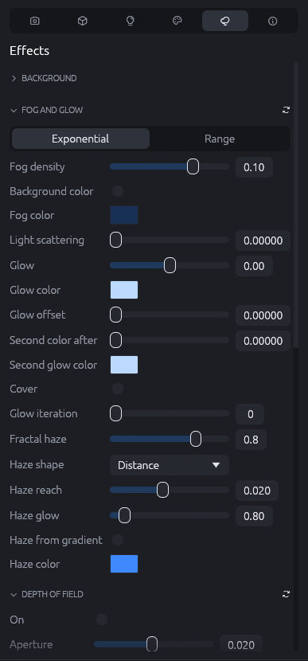
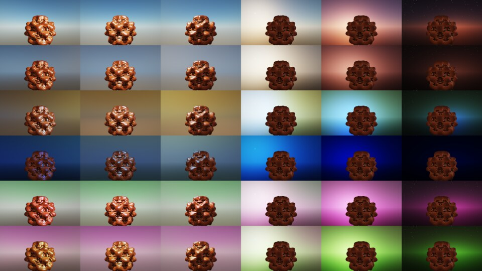
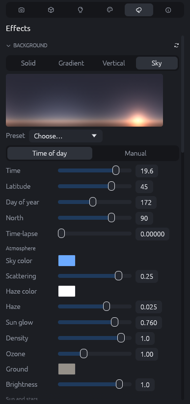
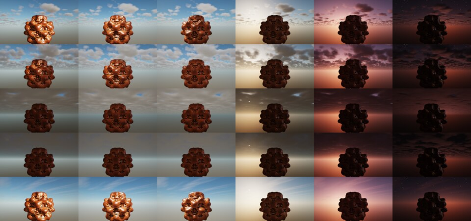
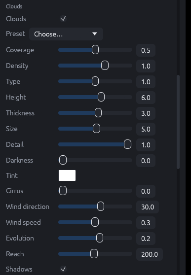
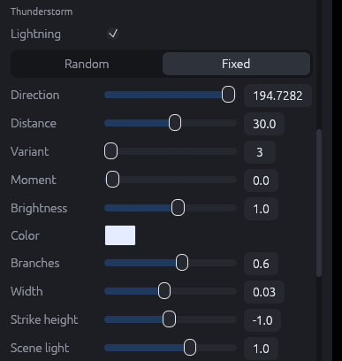

# Effects

The **Effects** tab (the fog icon) holds what lies around and between the surfaces: the
background, fog and glow, the fractal haze, depth of field and cutting planes. Its last section,
**Image**, has its own chapter ("Image").

Each section has a ↻ button that resets it to the defaults.

## Background

The background shows where rays hit nothing. Choose its kind:

- **Solid**: one **Color**.
- **Gradient** (default): a sky gradient with **Top**, **Horizon** and **Bottom** colors.
- **Vertical**: from **Top** to **Bottom** over the screen height, like Mandelbulb3D. **Curve**
  bends it: 1 is even, above 1 more of the top color, below 1 more of the bottom color.
- **Sky**: an atmosphere lit by the sun (below).

### Sky

The sky mode computes the light of an atmosphere for every direction: a blue sky with a paler
horizon by day, red and orange sunsets with a blue dusk above them, twilight after sunset and
stars at night. The colors of the air and its haze are settings, so Mars (butterscotch by day,
blue at sunset), Titan or invented planets are as easy as Earth. Below the horizon lies the
ground, hazed toward the horizon. A strip at the top of the section shows the sky all around
(north, east, south, west, from just below the horizon to the zenith).

{: .half}

**Preset** sets the atmosphere: colors, haze, density, ozone, ground and sun color. The sun's
place, the stars and the brightness stay.

The sun is placed by **Time of day** (real solar geometry) or **Manual**:

| Setting | What it does |
|---------|--------------|
| **Time** | Local solar time in hours; at 12 the sun is highest (in the south for northern latitudes). |
| **Latitude** | Degrees north (negative: south). Near the poles the sun stays low or never sets. |
| **Day of year** | 1 = January 1st, 172 = the longest day in the north. |
| **North** | Direction of north in the world, in degrees from the x axis (like a light's direction). |
| **Direction**, **Height** | Manual: the sun's direction from the x axis and its height above the horizon (negative: below it; the twilight lasts to -18°). |
| **Time-lapse** | Hours per second in animations (0: the time stands still). |

| Atmosphere | What it does |
|------------|--------------|
| **Sky color**, **Scattering** | The colors the air scatters most (Rayleigh scattering) and how much: a deeper sky, a whiter horizon, redder sunsets. |
| **Haze color**, **Haze** | Haze or dust (Mie scattering): a paler sky and a glow around the sun. |
| **Sun glow** | How tightly the haze gathers around the sun (0: evenly, 0.95: a small bright halo). The Mars preset sets it per color (blue scatters more forward: blue sunsets); the slider moves all three. |
| **Density** | Thickness of the atmosphere (multiplies scattering and haze). |
| **Ozone** | Ozone high above absorbs orange and green along the low sun's long path: it keeps the sky blue at dusk (Earth: 1). |
| **Ground** | Color of the ground below the horizon. |
| **Brightness** | Overall brightness of the sky and the stars. |

| Sun and stars | What it does |
|---------------|--------------|
| **Sun color** | Color of the sunlight before the atmosphere. |
| **Sun size**, **Disk brightness** | Angular diameter of the sun disk in degrees (ours: 0.53) and its brightness (0: no disk, only its light). |
| **Stars**, **Star brightness** | How many stars show where the sky is dark, and how bright. |
| **Sun lights the scene** | Light 1 follows the sun: its direction, its color (redder when low) and its intensity, which fades out at sunset. The ambient light takes the average light of the sky and the ground as its colors: shadows are filled bluish by day, warm at sunset, and the night is dark. Its **Amount** (Light tab) stays yours and scales this skylight; it is set to 1 (the sky's own brightness) when the sky starts lighting the scene. If the scene has no light, the sky adds light 1. The Light tab shows notes; these settings are then set by the sky. |
| **Sunlight** | Intensity of light 1 relative to the sun. |
| **Environment light** | The sky lights the scene like an HDRI image (on by default): see below. Off, the ambient light is two colors, the sky's average above and the ground's below. |
| **Only the sky** | Only the sky lights the scene: the sun, the environment light and lightning. Your other lights are left out of renders but kept (the Light tab marks them). |

With **Fog › Background color**, the fog takes the sky's air in each direction (without the
sun disk and the stars): distant things fade into the horizon's color, and water melts into
the sky at the horizon.

!!! tip
    For a quick time-lapse, set **Time-lapse** to 1–2 hours per second and export an
    animation: the sky, the sun light and its shadows follow the time.

### Clouds

**Clouds** (in the sky's settings) adds volumetric clouds: a layer of real three-dimensional
clouds above the scene, lit by the sky's sun (white by day, golden and pink at sunset, dark at
night), casting moving shadows, reflected by the water. The camera can fly into them, and the
fractal can tower into them.

{: .half}

**Preset** sets the look: coverage, density, type, thickness, darkness and cirrus. The height,
size, wind and reach stay.

| Setting | What it does |
|---------|--------------|
| **Coverage** | Share of the sky the clouds cover: 0 clear, 1 overcast. A large-scale pattern varies it from place to place. |
| **Density** | How dense and opaque the clouds are. |
| **Type** | 0 stratus (a thin flat layer), 1 cumulus (puffy heaps), 2 cumulonimbus (towering storm clouds that spread at the top). |
| **Height**, **Thickness** | Height of the cloud base above the world's zero level and the thickness of the layer, in world units. Towering types need a thick layer. |
| **Size** | Typical size of a single cloud (world units). |
| **Detail** | How much the edges are torn into wisps (at the bottom) and billows (at the top). |
| **Darkness** | Darker clouds that scatter less light: rain and storm clouds. |
| **Tint** | Color of the clouds' own reflection; white for Earth, any color for other planets. |
| **Cirrus** | Thin high streaks above the clouds. |
| **Wind direction**, **Wind speed** | Where the clouds drift in animations, and how fast (world units per second). |
| **Evolution** | How fast the clouds change their shape in animations. |
| **Reach** | How far the layer is drawn in detail (default 1000). Beyond it a distant deck closes the horizon as far as the coverage says, and far clouds fade into the haze of the horizon. The steps are spaced closer near the camera, so near clouds keep their detail. |
| **Planet radius** | The layer curves down with the planet's ground, like real clouds: toward the horizon they sink and pile up. 0 makes the layer flat. |
| **Shadows** | The clouds shade the scene from the sun (light 1, when **Sun lights the scene** is on): moving shadows on the sea and the fractal, light shafts in the fog. |

#### Environment light

With **Environment light** on, the sky and its clouds light the scene from every direction,
like an HDRI image: a sunset glow lights the faces toward it warm and bright, the zenith
lights the tops blue, a bank of clouds dims the side where it stands. RMandelbulb3D renders
the sky (without the sun disk: the sun stays light 1) into a small panorama around the
scene's center and from it the light each surface direction receives. The ambient
**Amount** (Light tab) scales it and ambient occlusion shades it; path tracing's bounces see
the panorama itself. Reflections always show the real sky and clouds.

With clouds, the skylight (ambient light) is the sky's light seen through them: an overcast
sky lights the scene grey and dim, and the ground below the horizon lies in their shade.

!!! tip
    Clouds are sized in world units, like everything else. For the default scene (the bulb
    about 2 units across) the defaults put the cloud base 6 units up. For a large scene, raise
    **Height**, **Thickness**, **Size** and **Reach** together.

!!! note
    Clouds take time to render: they double the work of the pixels that see the sky in the
    worst case. Scenes without clouds are not slowed down.

### Thunderstorm

**Lightning** (in the sky's settings) adds lightning: jagged bolts from the cloud base down
to the ground or the sea, and flashes inside the clouds. A strike lights the clouds from
inside and throws its light on the scene, with shadows; the water reflects the bolt. Each
strike flickers with two to four strokes over about half a second, the branches fade first.

{: .half}

Choose how strikes come:

- **Random**: as the animation runs, strikes come at random times, places and shapes. A
  still shows a strike only when its time hits one, so use *Fixed* for stills.
- **Fixed**: one bolt where you place it, at the moment of the flash you choose.

| Setting | What it does |
|---------|--------------|
| **Strikes** | Random: strikes per minute. |
| **Sequence** | Random: number of the random sequence (another number, other strikes). |
| **Nearest**, **Farthest** | Random: the distance range of strikes around the scene's center (world units). |
| **Cloud flashes** | Random: share of strikes that only light the clouds from inside, without a bolt. |
| **Direction**, **Distance** | Fixed: where the bolt strikes, in degrees from the x axis and world units from the scene's center. |
| **Variant** | Fixed: the bolt's shape; every number gives another path and other branches. |
| **Moment** | Fixed: the moment of the flash, from the first and brightest stroke (0) to the end of the strike (1). |
| **Brightness**, **Color** | Brightness and color of bolts and flashes (bluish white on Earth). |
| **Branches** | How much the bolts branch. |
| **Width** | Width of a bolt's channel (world units). Far bolts are drawn at least a pixel wide, so they stay visible. |
| **Bolt top** | Without clouds: the height where bolts start (with clouds they start at the cloud base). |
| **Strike height** | Where bolts end: the ground or the sea level. |
| **Scene light** | How strongly a strike lights the scene: a direct light along the bolt with shadows and, when the sky lights the scene, a flash of the ambient light from the clouds. |

!!! tip
    A strike's light is added after your own lights. With all eight lights in use, the
    strike still glows and lights the clouds, but not the scene.

### Background image

**Image…** puts a panorama image (latitude/longitude) behind the scene. The × removes it. A file
name that is not found is shown as a warning: give the full path or put the file in the maps folder
(Preferences › Maps).

| Setting | What it does |
|---------|--------------|
| **Brightness** | Brightness of the image, and of the ambient light taken from it (0–4, default 1). |
| **Smooth** | Softens the image when it loads, against noise and hard pixel edges (Mandelbulb3D's "smooth" option). |
| **Fill the screen** | The image fills the screen instead of surrounding the scene. Reflections still see it by angle. |
| **Rotate X/Y/Z** | Turns the panorama (degrees). Not with Fill the screen. |
| **Make spherical** | Squeezes a flat photo toward the poles so it wraps around the scene with less distortion (Mandelbulb3D's "convert to spherical"). |
| **Blend borders** | Blends the left and right edges into each other, so the panorama has no seam. |
| **Fog on top** | The fog is added on top of the image instead of covering it. |
| **Ambient light** | The image lights the scene: a blurred copy replaces the sky and ground colors of the ambient light (Lighting › Ambient). |

!!! note
    The fog keeps using the background *colors* above (or the sky), also when an image is
    shown.

## Fog and glow

### Depth fog

Depth fog lets the scene fade into a color with the distance. Two kinds:

- **Exponential** (default): the fog grows exponentially with the distance. **Fog density** is
  the fog per unit of distance (0 = off).
- **Range**: the fog grows over the view range, from the **Near** to the **Max distance** of the
  Ray marching tab (Mandelbulb3D's depth fog).

| Setting (Range) | What it does |
|-----------------|--------------|
| **Fog strength** | Fog amount at the far end (0 = off). |
| **Fog start** | Where in the range the fog begins; before it the image gets brighter. |
| **Fog curve** | 0: even over the range; higher values put more fog close to the camera. |
| **Far fog** | Squares the fog amount: less fog close by (Mandelbulb3D's far fog). |

**Background color** makes the fog take the background color behind each pixel; otherwise it
uses **Fog color**.

### Light scattering

**Light scattering** makes the fog scatter light toward the camera: beams of light through gaps
in the fractal ("god rays") and lit haze around lights (0 = off). It needs fog. **Forward
scattering** above 0 makes the fog shine most when you look toward a light, like real haze; 0
scatters evenly; below 0 shines back toward the light.

It casts one more shadow ray per sample, so it needs more samples to get smooth.

### Glow

**Glow** adds light along rays that pass close to the surface: Mandelbulb3D's *dynamic fog*.
Negative values darken instead.

| Setting | What it does |
|---------|--------------|
| **Glow** | Strength (−4–4, default 0). |
| **Glow color** | The first glow color. |
| **Glow offset** | Ray steps that give no glow yet. |
| **Offset per distance** | Ray steps added to the glow offset per unit of distance from the camera; negative values give more glow farther away (Mandelbulb3D's fog offset Z). |
| **Second color after** | Ray steps until the glow has the **Second glow color** (0 = only the first color). |
| **Cover** | The glow covers the image instead of adding light. |
| **Glow iteration** | Only ray steps where the fractal escaped after this many iterations glow (0 = all steps). |

The glow grows with the number of ray steps, so it also depends on **Step** and **Max steps**.

## Fractal haze

**Fractal haze** is a glowing volume shaped by the main fractal. It shines by itself and hides
what lies behind it (0 = off). Its **Haze shape** decides where it is:

- **Distance** (default): thickest at the surfaces, fading with the distance from them. It hugs
  every structure and fills narrow gaps. **Haze reach** sets how far it reaches, relative to the
  distance from the camera.
- **Iterations**: where the fractal's orbits take long to escape, which gives shells around the
  fractal (Mandelbulber's iteration fog). **Haze from** is the share of the maximum iterations
  from which on there is haze (higher: closer to the fractal); **Haze to** is the share above
  which there is none again (lower values keep it out of regions that never escape).

| Setting | What it does |
|---------|--------------|
| **Haze glow** | Brightness of the haze's own light (0: a dark smoke that only hides). |
| **Haze from gradient** | The haze takes the gradient's colors by the iteration count instead of one **Haze color**. |

!!! tip
    *Iterations* depends a lot on the formula. On a Mandelbulb the high counts occur only in a
    thin shell at the surface; on scenes with large regions that never escape it covers
    everything. Start with *Distance* and a small reach.

## Depth of field

Depth of field blurs everything outside the focus distance, like a camera lens.

| Setting | What it does | Range / default |
|---------|--------------|-----------------|
| **On** | Switches the blur on. | off |
| **Aperture** | Lens size: more blur. | 0.0005–1, default 0.02 |
| **Focus distance** | Distance from the camera that is sharp. | default 2.5 |
| **Blades** | The shape of the lens opening, which out-of-focus highlights take on (bokeh): 0 is round, 3 to 9 give a polygon with that many corners (5 or 6 look like a real camera lens). | 0 |
| **Blade rotation** | Turns the polygon (degrees; with 3 or more blades). | 0° |

**Double-click** into the view to look at a point and set the focus distance there. The blur is
sampled, so it refines with the samples.

## Cutting planes

Each of the three cutting planes, **Cut X**, **Cut Y** and **Cut Z**, removes everything on one
side of a plane across that world axis:

- the check box switches the plane on;
- the number is the position along the axis;
- **keep +** keeps the part above the position (else the part below).

Cuts open the fractal to show its inside. Scenes imported from Mandelbulb3D may bring
**Interior colors** for the cut faces (Color › Mapping).
