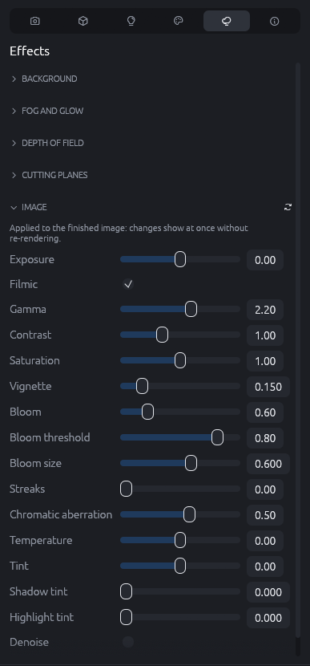

# Image

The **Image** section at the end of the Effects tab works on the finished image, like the
development of a photo. Its changes show at once, without rendering again: in the preview, and in
the render window on the image already rendered (chapter "Render and export").

The ↻ button resets all Image settings to the defaults.

## Settings

| Setting | What it does | Range / default |
|---------|--------------|-----------------|
| **Exposure** | Brightness in photographic stops: +1 doubles the light, −1 halves it. | −4–4, default 0 |
| **Filmic** | Filmic tone mapping: very bright parts roll off softly instead of clipping to white. | on |
| **Gamma** | The output gamma. Higher values lift the dark and middle tones. | 1–3, default 2.2 |
| **Contrast** | Spreads or compresses the tones around the middle. | 0.5–2, default 1 |
| **Saturation** | 0 is grayscale, 1 unchanged, 2 very colorful. | 0–2, default 1 |
| **Vignette** | Darkens the corners. | 0–1, default 0.15 |
| **Bloom** | A soft glow around bright parts, like light scattering in a lens (0 = off). | 0–3, default 0 |
| **Streaks** | Lines of light through very bright parts, as a camera lens shows them (0 = off). | 0–3, default 0 |
| **Chromatic aberration** | Colored fringes toward the edges, like a cheap lens: red drawn outward, blue inward, by this many percent of the distance from the center (0 = off). | −3–3, default 0 |
| **Temperature** | White balance: warmer (above 0) or cooler colors. | −1–1, default 0 |
| **Tint** | White balance: toward magenta (above 0) or green. | −1–1, default 0 |
| **Shadow tint** | Split toning: the dark parts take the **Shadow color** by this much; brightness stays. | 0–1, default 0 |
| **Highlight tint** | Split toning: the bright parts take the **Highlight color** by this much. | 0–1, default 0 |
| **Denoise** | Runs the AI denoiser on saved images (below). | off |
| **Display space** | Lights the colors as shown instead of in linear light (below). | off |

### Bloom

With **Bloom** above 0, two more settings appear:

- **Bloom threshold**: the brightness above which parts bloom, after exposure (1 = white).
  Lower values make more of the image glow.
- **Bloom size**: 0 gives a tight halo, 1 a wide glow over large parts of the image.

Bloom brings out emissive colors and glow bands (chapter "Color") especially well.

### Streaks

With **Streaks** above 0:

- **Streak threshold**: the brightness above which parts make streaks (after exposure; 1 =
  white; default 2).
- **Streak length**: as a share of the image width.
- **Streak angle**: in degrees; 0 is horizontal, like anamorphic lenses.
- **Streak directions**: 1 a line, 2 a cross, 3 and 4 stars.
- **Streak tint**: multiplies the light the streaks spread.

### Split toning

Split toning colors the shadows and the highlights differently while keeping the brightness, a
common grading look. The default colors are teal for the shadows and orange for the highlights;
the color pickers appear when the amount is above 0.

## Denoise

**Denoise** runs Intel Open Image Denoise, an AI denoiser, on saved images: exports, renders
from the render window and the command line. It removes the grain of ray traced occlusion, soft
shadows, depth of field and path tracing, so far fewer samples are needed. Besides the image it
uses the surface color and normal of the first hit, so edges and textures stay sharp.

- **Denoise amount**: 1 keeps only the denoised image; less mixes the original back in, which
  keeps some grain and fine detail.
- The hover text of the check box shows where the denoiser library was found, or why it is not
  available.
- **Denoised** in the top bar shows the preview through the denoiser as well. It updates at 1,
  4, 16, 64, … samples. Saving denoises only when the **Denoise** check box here is on.

See chapter "Render and export" for recommended sample counts.

## Display space

Normally RMandelbulb3D computes light in *linear* light, as physics does, and applies the gamma
at the end. **Display space** lights the colors as they are shown, as Mandelbulb3D does: stronger
colors and harder light. Scenes imported from Mandelbulb3D usually use it.

- Unlike the other settings, it changes the render itself: the preview renders again, and the
  render window asks you to render again.
- With Display space on, a **Gamma** of 2.2 leaves the image unchanged.

## Order of operations

The finished image goes through these steps, in this order:

1. **Denoise** (when on), mixed with the original by the amount.
2. **Lens flares** of the lights (chapter "Lighting") are added.
3. **Bloom** and **Streaks**.
4. **Chromatic aberration**.
5. Then, for every pixel:
    1. **Exposure** and white balance (**Temperature**, **Tint**);
    2. **Filmic** tone mapping;
    3. **Saturation**;
    4. split toning (**Shadow tint**, **Highlight tint**);
    5. **Gamma**;
    6. **Contrast** and **Vignette**, and the result is clipped to the displayable range.

A few things follow from the order:

- Bloom and streaks see the image before exposure is applied per pixel, but their thresholds
  are measured after exposure, so raising **Exposure** makes more parts bloom.
- White balance acts before the tone mapping, split toning after the saturation: lowering
  Saturation to 0 still leaves the split toning colors.
- The vignette darkens the final tones, so it does not change the bloom.

!!! tip
    Without **Filmic**, bright parts clip to flat white. Keep it on for emissive scenes and
    bloom, and use **Exposure** rather than the light intensities to set the overall brightness.
