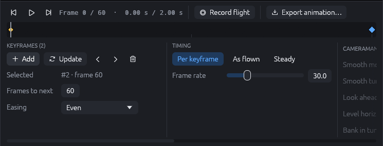
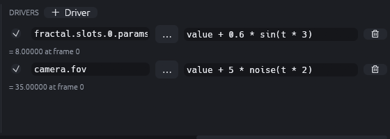

# Animation

RMandelbulb3D animates with **keyframes**. A keyframe is a whole scene: the camera and every
setting. Between the keyframes the camera follows a smooth path, and every other number blends
from one keyframe to the next. You can place keyframes by hand or fly through the fractal and let
the program create them.

Open the timeline with **Animation** in the top bar. It appears below the view.

## The timeline

The top row holds the transport controls:

- **First frame**, **Play / Pause** and **Last frame**. Playback shows the animation in the
  view at fast preview quality.
- The frame counter: current frame and time, and the total.
- **Edit**: shown while the view shows an animation frame. It returns to editing the scene.
- **Record flight** / **Stop recording** (see below).
- **Export animation…** opens the export window on the animation part (chapter "Render and
  export").

Below is the **scrubber**. The diamonds are the keyframes, the ticks mark the seconds.

- Click or drag on the scrubber to look at a frame. While a frame is shown, navigation in the
  view is off; the view says so.
- Click a diamond to load that keyframe for editing.

While the timeline is open, the camera path of the animation is drawn over the view, with the
keyframe positions and the current frame.

## Keyframes

The **KEYFRAMES** column:

| Control | What it does |
|---------|--------------|
| **Add** | Adds the current view and settings as a keyframe after the selected one (or at the end). |
| **Update** | Stores the current view and settings into the selected keyframe. |
| ‹ and › | Move the selected keyframe earlier or later. |
| Trash icon | Deletes the selected keyframe. |
| **Frames to next** | *Per keyframe timing:* frames from this keyframe to the next (double-click: 60). |
| **Easing** | *Per keyframe timing:* how those frames are spread: *Even*, *Slow in and out*, *Slow start*, *Slow end*. |

The usual way to work:

1. Set up the first view and click **Add**.
2. Move the camera, change colors or any other setting, and click **Add** again.
3. To change a keyframe later, click its diamond, edit the scene, and click **Update**.

!!! note
    Editing always happens on the scene itself. Clicking a diamond loads that keyframe's scene;
    your changes go into the keyframe only when you click **Update**.

### How the scene moves between keyframes

- The camera position follows a smooth spline through the keyframe positions that never
  overshoots or makes loops; the camera orientation turns smoothly as well.
- Every other number (colors, light positions, formula parameters, fog, …) blends smoothly
  between the keyframe values without overshooting. Whole numbers are rounded. Settings that are
  not numbers, such as a check box or a formula choice, keep the value of the keyframe before.

## Timing

The **TIMING** column decides how the frames are spread over the path.

| Timing | What it does |
|--------|--------------|
| **Per keyframe** | Frames and easing set per keyframe. |
| **As flown** | The pace of the recorded flight, with its speed changes smoothed out. **Smooth speed** sets over how many seconds (0: exactly as flown). |
| **Steady** | One steady pace over the whole length; frames are added or removed between keyframes. |

**Frame rate** sets the frames per second (default 30). Steady timing adds:

| Setting | What it does | Default |
|---------|--------------|---------|
| **Length** | Length of the animation in seconds. | 10 |
| **Ease in** | Seconds to speed up at the start. | 1 |
| **Ease out** | Seconds to slow down at the end. | 1 |
| **Relative to surface** | Speed relative to the distance to the surface: slower close to it, as it feels. This keeps zoom flights even. Off: even in world units. | on |

## Recording a flight

**Record flight** switches the view to Fly mode and records the camera while you fly (WASD, R/F,
Q/E, drag to look; chapter "Camera and navigation"). **Stop recording** ends it: keyframes are created along the
flight, the timing switches to *As flown* (if it was Per keyframe), and the view shows frame 0
of the new animation. The time before the first and after the last movement is left out.

The **RECORDED FLIGHT** column then shows the length and number of samples:

- **Key tolerance**: how closely the keyframes follow the flight. Smaller values give more
  keyframes and a more exact path (default 0.05).
- **Keyframes again**: creates the keyframes from the recorded flight again with the current
  tolerance. This replaces the keyframes.
- **Forget**: removes the recorded flight; the keyframes stay.

!!! tip
    A recorded flight keeps the scene settings that were current when you stopped. Change colors
    or lights afterwards on single keyframes with **Update**.

## Cameraman

The **CAMERAMAN** column smooths the camera like a professional camera operator: no jerks from
keys or mouse, smooth turns and climbs. It works with every timing, as an automatic correction
over the finished path. Switch it on with the check box.

| Setting | What it does | Default |
|---------|--------------|---------|
| **Smooth moves** | Seconds over which the position is smoothed; larger is steadier and rounder. | 0.5 |
| **Smooth turns** | Seconds over which turning and tilting are smoothed. | 0.8 |
| **Look ahead** | Turns the view toward the direction of travel. | 0 |
| **Level horizon** | Removes rolling and keeps the horizon level. | 0 |
| **Bank in turns** | Rolls into turns like a plane or a drone. | 0 |

## Things that move by themselves

Some settings are speeds. They act only in animations, adding up over the frames:

- **Rotation** (Color › Mapping): the gradient turns by this many gradient lengths per second
  (palette rotation).
- The **speed** of each glow band: the band wanders through the gradient while the colors stay.
- **Drift X/Y/Z** of texture layers: tiles per second.
- **Steam drift X/Y/Z** (Emissive colors): the steam clouds move.
- **Shimmer speed**: new flicker patterns per second.

These speeds can themselves differ between keyframes; the program blends them and sums them up
over time, so the movement stays smooth.

## Drivers

A driver computes one value of the scene in every frame from an expression: a power that
breathes, a field of view that wobbles, a fog that pulses with the beat. Drivers act after the
keyframes, in the preview, the export, the render queue and network renders.

Click **+ Driver** in the **DRIVERS** column of the timeline (scroll the settings to the
right), choose the value with **…** (type to search: *power*, *fov*, *fog* …) and write the
expression. Below each driver its value at the current frame shows, or what is wrong with the
expression.

| In an expression | Meaning |
|------------------|---------|
| `t` | Time in seconds since the first frame. |
| `frame`, `frames` | The frame number (from 0) and the number of frames. |
| `u` | Progress through the animation: 0 at the first frame, 1 at the last. |
| `key` | Position between the keyframes (0 at the first, 1 at the second …). |
| `fps` | Frames per second. |
| `value` | The value the keyframes give at this moment (or the formula's default). |
| `@path` | Another value of the scene, for example `@camera.fov`. |
| `pi`, `e` | The constants. |
| `+ - * / % ^` | Arithmetic; `^` is the power, `%` the remainder. |
| `< <= > >= == !=` | Comparisons: 1 when true, else 0. |
| `sin cos tan asin acos atan atan2` | Angles in radians; `deg(x)` and `rad(x)` convert. |
| `sqrt abs exp ln log10 pow` | |
| `min max clamp(x, lo, hi) mix(a, b, t)` | |
| `step(edge, x) smoothstep(a, b, x)` | Hard and soft steps from 0 to 1. |
| `floor ceil round fract sign` | |
| `noise(x)` | A smooth random wobble between −1 and 1 (the same every time). |
| `if(c, a, b)` | `a` when `c` is above 0, else `b`. |

Examples:

| Value | Expression | Effect |
|-------|------------|--------|
| `fractal.slots.0.params.power` | `value + 0.6 * sin(t * 3)` | The bulb breathes around the keyframed power. |
| `camera.fov` | `value + 3 * noise(t * 2)` | A slightly unsteady zoom, like a hand-held camera. |
| `fog.density` | `value * (1 + 0.5 * step(0.5, fract(t * 2)))` | The fog jumps twice a second. |
| `material.color_offset` | `u` | The colors run through the gradient once over the animation. |
| `fractal.max_iterations` | `mix(10, 30, smoothstep(0, 1, u))` | More detail toward the end (whole numbers stay whole). |

Paths name the scene's settings as they are stored in the scene file (`.rmb`, JSON):
sections and names separated by dots, list entries by number from 0 (the first slot is
`fractal.slots.0`). The picker lists all of them with their current values. On/off settings
take values above 0.5 as on.

## Movie settings

The **MOVIE** column holds settings that apply to the exported movie.

### Motion blur

**Motion blur** sets how long each frame is exposed, as a fraction of the frame time: 0 is sharp,
0.5 a film camera's 180° shutter, 1 fully smeared. Camera moves and animated settings blur, and
every sample is taken at its own time within the exposure, so fast moves give smooth streaks
instead of ghost copies. It needs enough samples for smooth streaks. Motion blur shows only in
exported animations.

### Sound

**Sound…** picks a sound file (WAV, MP3, FLAC, OGG, Opus, M4A, AAC) that is put under exported
movies (MP4, MOV, WebM; not GIF). The movie keeps its length: the sound is cut at its end or
filled with silence. The trash icon removes it.

**Sound offset** is where in the sound file frame 0 starts, in seconds. Negative values start the
sound later.

## Exporting a movie

**Export animation…** (in the timeline or **File › Export animation…**) renders the animation.
The formats:

| Format | Notes |
|--------|-------|
| **MP4 (H.264)** | Plays everywhere. Sound as AAC. |
| **MP4 (H.265)** | Smaller files. Sound as AAC. |
| **MOV (ProRes)** | ProRes 422 HQ, for editing. Sound as PCM. |
| **WebM (VP9)** | For the web. Sound as Opus. |
| **GIF** | One 256-color palette for the whole animation, no sound. |
| **PNG images** | Numbered PNG files in a folder (`frame_00000.png` …). |

All movie formats are written by **ffmpeg**, which must be installed. If it is not on the search
path, choose the program in **Preferences › Movies**. Without ffmpeg only PNG images are
available. Chapter "Render and export" describes the export window, and the command line program
can render animations as well (`rmb-cli animate`).
