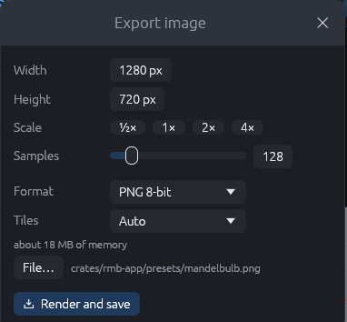
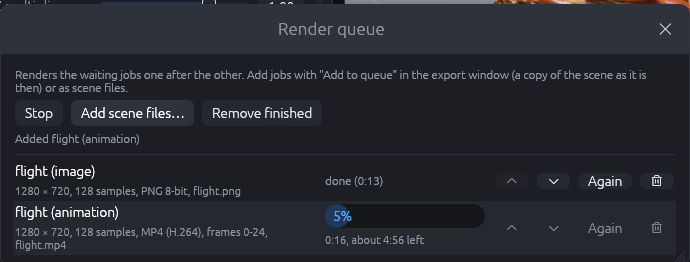
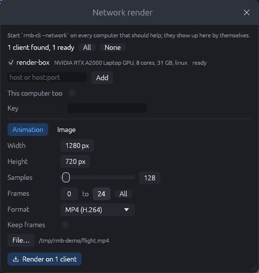
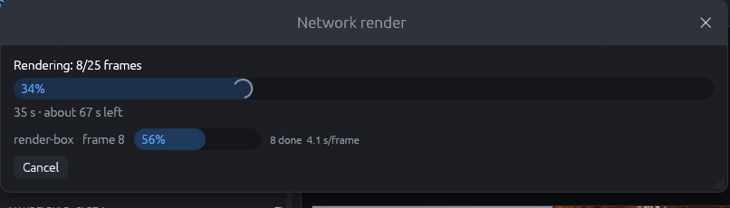
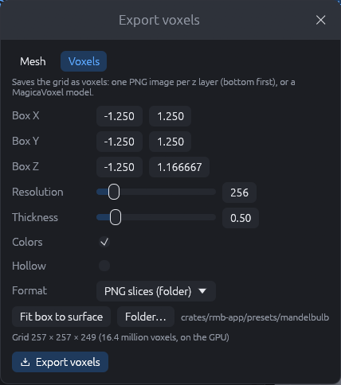

# Render and export

The preview in the view refines while you look at it, but it stops at a set number of samples
(Preferences › Preview › Samples) and shows the denoiser only when **Denoised** is on in the top
bar. For the final image there are three ways:

- the **render window** (<kbd>F12</kbd>): a test render with everything the export applies;
- the **export window** (<kbd>Ctrl</kbd>+<kbd>E</kbd>): renders and saves an image or an
  animation;
- the command line program **rmb-cli**, for renders without the user interface.

## Samples

Every *sample* is one complete pass over the image with slightly different random choices: a
different point inside each pixel (anti-aliasing), different occlusion and shadow rays, different
points on area lights and on the lens. The image is the average of all samples, so noise fades as
the count grows.

How many you need depends on the scene. With **Denoise** on (Effects › Image):

- **Still images**: 16–32 samples with the denoiser look cleaner than 64 without it, in a
  quarter to half of the time.
- **Animations**: the denoiser works frame by frame and rebuilds fine fractal detail slightly
  differently each time, which shimmers. At 16 samples this is about twice as much as 64 samples
  without the denoiser, at 32 samples 1.4 times as much. Use 64 samples (with or without the
  denoiser) for animations with much fine detail. Without the denoiser, the noise pattern stays
  the same from frame to frame and does not flicker.

Scenes with path tracing, glossy reflections, glass, light scattering, emissive light or motion
blur need more samples than plain classic shading.

## Render window

**Render** in the top bar or <kbd>F12</kbd> opens the render window and starts a render of the
current scene.


| Control | What it does |
|---------|--------------|
| **Size** | A share of the image size set in the Camera tab: 25 %, 50 % (default) or 100 %. |
| **Samples** | Samples per pixel (1–4096). Starts with the export samples of the preferences; double-click: 64. |
| **Render** | Renders the current scene again (<kbd>F12</kbd>). |
| **Cancel** | Stops rendering and keeps the image so far. |
| **Save PNG…** | Saves the image as shown, with the scene inside the PNG. |
| **Fit** / **100 %** | Scales the image to the window, or shows one image pixel per screen pixel (scroll to move). |

The image refines while it renders. It contains everything a saved image gets: the denoiser,
lens flares, bloom, streaks and all Image settings.

**Developing again.** When the render is done, the window keeps the raw image. Changing any
setting of the Image section (exposure, bloom, tint, denoise amount, …) develops this raw image
again in the background, so the change shows within moments, without rendering again. The
denoised image is kept as long as the denoise settings stay the same. Only **Display space**
changes the render itself; the window then asks you to render again.

!!! tip
    Use the render window at 25 % or 50 % to judge noise, bloom and color grading, then export
    at full size. While the render window or an export is busy, the preview pauses so the two do
    not compete for the graphics card.

## Export window

**Export** in the top bar, **File › Export image…** or <kbd>Ctrl</kbd>+<kbd>E</kbd> opens the
export window. When the scene has keyframes, two buttons at the top choose between **Image** and
**Animation**.



### Image

| Control | What it does |
|---------|--------------|
| **Width**, **Height** | Size in pixels (16–32768). Changing one changes the other with the scene's aspect. |
| **Scale** | ½×, 1×, 2×, 4× of the scene's image size. |
| **Samples** | Samples per pixel (1–1024). The default comes from **Preferences › Interface › Export samples** (128). |
| **Format** | **PNG 8-bit**, **PNG 16-bit** or **EXR (linear, passes)**, see below. |
| **Tiles** | Renders large images in parts and puts them together, see below. **Auto** uses tiles of 2048 pixels above about 16 megapixels. The line below shows the tile count and the memory the export needs. |
| **File…** | Where to save the image. It defaults to the scene file's name. |
| **Render and save** | Renders in the background and saves. A progress bar shows the remaining time; **Cancel** stops it. |

PNG images are saved with the scene stored inside. Opening such a PNG in RMandelbulb3D (or
dropping it onto the window) restores the scene. When **Denoise** is on, the status message says
whether and where the image was denoised.

| Format | Content |
|--------|---------|
| PNG 8-bit | The image as shown, with lens flares, bloom and all **Image** settings. |
| PNG 16-bit | The same with 16 bits per channel: no banding in dark gradients and fog when you edit the image further. |
| EXR (linear, passes) | OpenEXR, 32-bit float, lossless compression: the linear light *before* the **Image** settings (denoised when **Denoise** is on; no lens flares, bloom, exposure, tone mapping or color grading), for compositing and grading in other programs. Scenes in display space (Mandelbulb3D imports) are converted to linear light. |

**Tiles.** The graphics card keeps about 52 bytes per pixel while rendering, so very large
images (prints, 8K and more) do not fit at once. With tiles, the export renders one part after
the other and puts them together in main memory (about 20 bytes per pixel; the line under the
settings shows the estimate). Every tile renders exactly the pixels a render of the whole image
would: without the denoiser the result is identical. With the denoiser, each tile is denoised
with an overlap of 64 pixels that is cut off, so no seams show. Lens flares, bloom and the
**Image** settings work on the finished image as usual. An 8192 × 8192 image of the Mandelbulb
preset with 4 samples took about a minute on an RTX A2000 laptop GPU and 1.6 GB of memory.

An EXR file holds these channels:

| Channel | Content |
|---------|---------|
| `R`, `G`, `B` | Linear color, including the background. |
| `coverage` | Share of the samples per pixel that hit a surface (1 on the fractal, 0 on the background, in between at edges): a matte for compositing. It is not a premultiplied alpha, since the color includes the background. |
| `Z` | Distance of the hits from the camera along the ray, in world units; infinite on the background. |
| `albedo.R/G/B` | The surface colors without lighting. |
| `normal.X/Y/Z` | World-space normals (z up). |

The scene is stored in the EXR header as the text attribute `rmandelbulb3d`; opening EXR files in
RMandelbulb3D is not supported.

### Animation

The animation part has the same size and sample settings, plus:

| Control | What it does |
|---------|--------------|
| **Format** | MP4 (H.264), MP4 (H.265), MOV (ProRes), WebM (VP9), GIF or PNG images. Movie formats need ffmpeg and are grayed out without it. |
| **Frames** | First and last frame to render, both included. **All** selects all frames. |
| **Length** | Frames and duration at the animation's frame rate. |
| **File…** / **Folder…** | The movie file, or the folder for numbered PNG images. |

A line tells whether the animation's sound track goes into the movie, is left out (GIF and PNG
images have no sound) or cannot be found. While rendering, the window shows the last finished
frame.

Chapter "Animation" explains the formats, sound and motion blur.

!!! note
    The export window and the render window need the GPU renderer. Without a usable graphics
    card, render with `rmb-cli render --cpu`.

## Render queue

The render queue renders images and animations one after the other, for example overnight.
Open it with **File › Render queue…** (the menu shows how many jobs are waiting).



- **Add to queue** in the export window adds a job with the window's settings (size,
  samples, format, frames, output file) and a *copy* of the scene as it is at that moment:
  you can go on editing the scene, or load another one, and add more jobs.
- **Add scene files…** adds one job per file: its animation when it has keyframes (MP4),
  otherwise an image (PNG), with 128 samples, saved next to the file.
- **Start** renders the waiting jobs from the top; the preview pauses meanwhile. **Stop**
  stops the current job (it becomes *paused*) and the queue.
- Per job: move it up or down, **Pause** it (skipped until you click **Again**), **Again** to
  render a finished or failed job once more, and the bin to remove it. **Remove finished**
  clears the jobs that are done.
- While a job runs, its progress bar shows the time so far and the time left.

The queue is saved in the settings folder (`rmandelbulb3d/queue.json` in the user's
configuration folder), so it survives closing the app. The command line can run the same file
without the app: `rmb-cli batch ~/.config/rmandelbulb3d/queue.json` (see below).

## Network rendering

Long animations and big stills render faster on several computers. There is nothing to set up
beyond starting a program on each helper:

1. On every computer that should help, start a **render client**:
   ```
   rmb-cli --network
   ```
   It shows its name and hardware and waits. Leave it running; it serves one job after the
   other.
2. On your computer, open **File › Network render…**. The clients appear in the list by
   themselves (they announce themselves on the local network every two seconds).
3. Choose the clients (all ready clients are chosen at first), set size, samples, frames and
   the output, and click **Render on N clients**.

{: .half}

| Setting | What it does |
|---------|--------------|
| Client list | Every client found, with its hardware and state: *ready*, *busy* (rendering for another server), *needs the key*, or another program *version* (not usable). **All** / **None** choose quickly. |
| host or host:port, **Add** | A client the announcements do not reach (another subnet, a network that blocks broadcasts), by its name or address. |
| This computer too | Renders on this computer's graphics card as well. |
| Key | The shared key, for clients started with `--key`. |
| Animation / Image | The keyframe animation (every client renders whole frames) or the current view as one image (every client renders a part of its samples; the parts are added up, so the result equals a render on one computer). |
| Width, Height, Samples, Frames, Format | As in the export window. Movies are encoded on this computer after the last frame; **Keep frames** keeps the PNG frames next to the movie. |

While the job runs, the window shows a progress bar for the whole job and one per client: the
frame it works on, how far it is, how many it finished and its speed. **Cancel** stops the
job; finished frames stay in the output folder.



How it works:

- **Fair share of the work.** Clients fetch the next frame whenever they are free, so a fast
  computer renders more frames than a slow one and nobody waits for the slowest machine. When
  the last frames are in progress and a fast client is idle, it renders the frame of a much
  slower client too; whichever finishes first counts and the other stops.
- **Files go along.** The scene goes to the clients with every file it uses: 3D models with
  their material files and textures, texture and background images, Mandelbulb3D maps and
  bokeh images. Clients keep them in their cache (by content), so the next job sends only
  what changed.
- **Nothing gets lost.** A client keeps every finished frame on its disk until this computer
  confirmed that it stored it. If the connection breaks, the server reconnects, and the client
  sends the frames it still holds first. A client that goes away gives its frame back to the
  others.
- **Only matching versions work together**, so every client renders exactly the same image.
- The clients announce only their name, port and hardware (processor, cores, memory, graphics
  card, operating system), no user data.

!!! note
    The network needs two ports open in the firewalls: **UDP 47810** (announcements, on the
    server) and **TCP 47811** (on the clients). Network rendering is meant for your own local
    network; with `--key` on the clients only servers that know the key can use them.

## Mesh and voxel export

While the window is open, the view shows the box as an orange wire frame.

**File › Export mesh…** saves the surface as a closed triangle mesh: for 3D printing, or to
use the fractal in Blender and other 3D programs. The distance estimate is sampled on a grid in
a box (on the GPU when there is one), and the surface between the samples becomes the mesh.
The export runs in the background; the preview pauses meanwhile.

{: .half}

| Setting | What it does | Default |
|---------|--------------|---------|
| Box X, Y, Z | The sampled box (from, to; world units). Opening the window fits it to the scene's surfaces; **Fit box to surface** does that again. Where the surface reaches the box, the mesh is closed by a flat cap, so cutting the box smaller exports a slice. | fitted |
| Resolution | Grid cells along the longest side of the box. The triangle count grows with its square: about 0.8 million at 256, 4 million at 512, 23 million at 1024 for the Mandelbulb. | 256 |
| Thickness | How far outside the fractal the surface lies, in grid cells. 0.5 keeps the shape; larger values thicken thin parts so they survive printing. | 0.5 |
| Remove pieces under | Removes loose pieces with fewer triangles than this share of the mesh, in percent: the dust of small separate bits around fractal surfaces, which printers cannot print. 0 keeps everything; 0.1 removes the dust and keeps the real parts. The status message tells how many pieces went. | 0 |
| Refine | Moves every vertex onto the surface after the grid placed it: sharper edges, a little slower. | On |
| Vertex colors | The scene's colors at every vertex (gradient, color maps, texture layers, model colors; no lighting). PLY and OBJ only. | On |
| Y up | Writes y as the up axis. RMandelbulb3D uses z up, like Blender's PLY import; Blender's OBJ import and many other programs expect y up. | Off |
| Format | **PLY**: binary, small, with normals and colors (Blender, MeshLab). **OBJ**: text, colors as the `v x y z r g b` extension many programs read. **STL**: binary, for the slicers of 3D printers, no colors. | PLY |

The line below the settings shows the grid size and whether the GPU or the CPU computes it.
On an RTX A2000 laptop GPU the Mandelbulb takes about 1 s at 256 and 17 s at 1024 (most of it
writing the 600 MB file).

!!! tip
    Fine fractal detail smaller than a grid cell becomes a smooth skin. Export a smaller box
    at the same resolution for close-ups, and use **Thickness** above 1 for prints: thin
    filaments break otherwise.

### Voxels

**File › Export voxels…** (or **Voxels** at the top of the same window) writes the grid as
voxels: a voxel is filled where the surface of the mesh export would enclose its center. Box,
resolution and thickness work as for meshes; the grid's samples are the voxels.

{: .half}

| Setting | What it does | Default |
|---------|--------------|---------|
| Colors | The scene's colors on the voxels next to empty space; the hidden inside of each layer gets that layer's mean color. Off: white voxels on black. | On |
| Hollow | Only the voxels next to empty space: the visible shell. Far fewer voxels, faster in MagicaVoxel. | Off |
| Format | **PNG slices**: a folder with one image per z layer (`slice_0000.png` is the bottom), seen from above with x to the right; colored voxels on transparency, or white on black. For 3D printers that print from slices, image tools and volume programs. **MagicaVoxel**: one `.vox` model (z up, like the scene). A model holds at most 256 voxels per side, so the resolution is limited to that, and the colors are reduced to a palette of 255. | PNG slices |

!!! note
    The mesh is closed and every triangle faces outward. A fractal's mesh can have many small
    separate pieces (dust around the surface); **Remove pieces under** takes them out. Inside
    rendering and deep zooms beyond about 10⁵ are not
    supported (the grid uses single precision on the GPU).

## Command line: rmb-cli

`rmb-cli` renders and converts scenes without the user interface. A *scene* is an `.rmb` file, a
Mandelbulb3D `.m3p` file, a text file with Mandelbulb3D clipboard parameters, or a PNG rendered by
RMandelbulb3D. Run `rmb-cli --help` for a summary.

### render

```
rmb-cli render <scene> [-o out.png|out.exr] [-W width] [-H height] [-s samples] [--cpu]
               [-t threads] [--denoise [blend] | --no-denoise] [--16bit] [--tiles size|off]
```

Renders one image and saves it as PNG with the scene inside, or as EXR with passes when the
output ends in `.exr` (see "Export window" above).

| Option | What it does |
|--------|--------------|
| `-o out.png` | Output file. Default: the scene's name with `.png`. |
| `-W`, `-H` | Width and height. Default: the scene's size; giving only one keeps the aspect ratio. |
| `-s samples` | Samples per pixel (default 64). |
| `--cpu` | Renders on the CPU instead of the GPU: much slower, but always in double precision. |
| `-t threads` | Threads of the CPU renderer. |
| `--denoise [blend]` | Runs the denoiser whatever the scene says; blend 0–1, default 1. |
| `--no-denoise` | Skips the denoiser. |
| `--16bit` | Writes a 16-bit PNG. |
| `--tiles size` | Renders in tiles of about `size` pixels per side (GPU only). Default: tiles of 2048 above about 16 megapixels; `--tiles off` never. |

### animate

```
rmb-cli animate <scene> [-o out.mp4|folder] [-W width] [-H height] [-s samples] [--cpu]
                [--fps n] [--from frame] [--to frame] [--denoise [blend] | --no-denoise]
                [--ffmpeg path] [--audio file [--audio-offset s] | --no-audio]
                [--shutter fraction]
```

Renders the scene's keyframe animation. The extension of `-o` picks the format: `.mp4` H.264,
`.mov` ProRes, `.webm` VP9, `.gif`; anything else is a folder of numbered PNG files. Default
output: the scene's name with `.mp4`.

| Option | What it does |
|--------|--------------|
| `--fps n` | Frame rate instead of the scene's. |
| `--from`, `--to` | First and last frame (both included). |
| `--ffmpeg path` | The ffmpeg program, if it is not on the search path. |
| `--audio file` | Sound track instead of the scene's; relative to the working folder. |
| `--audio-offset s` | Where in the sound frame 0 starts, in seconds. |
| `--no-audio` | Leaves the sound out. |
| `--shutter fraction` | Motion blur: exposure as a fraction of the frame time (0 = off, 0.5 = 180° shutter). |

`-W`, `-H`, `-s`, `--cpu` and the denoise options work as for `render`.

### mesh

```
rmb-cli mesh <scene> [-o out.ply|.obj|.stl] [-r resolution] [--box x0,y0,z0,x1,y1,z1]
             [--thickness cells] [--no-colors] [--no-refine] [--y-up] [--min-piece percent] [--cpu]
```

Exports the surface as a mesh, like **File › Export mesh…**. The extension of `-o` picks the
format (default: the scene's name with `.ply`).

| Option | What it does |
|--------|--------------|
| `-r resolution` | Grid cells along the longest side of the box (default 256). |
| `--box x0,y0,z0,x1,y1,z1` | The sampled box. Default: fitted to the surface. |
| `--thickness cells` | How far outside the fractal the surface lies (default 0.5). |
| `--no-colors`, `--no-refine` | Without vertex colors / without moving the vertices onto the surface. |
| `--min-piece percent` | Removes loose pieces with fewer triangles than this share of the mesh. |
| `--y-up` | Writes y as the up axis. |
| `--cpu` | Computes the distances on the CPU instead of the GPU. |

### voxels

```
rmb-cli voxels <scene> [-o folder|out.vox] [-r resolution] [--box x0,y0,z0,x1,y1,z1]
               [--thickness cells] [--no-colors] [--hollow] [--cpu]
```

Exports voxels like **File › Export voxels…**: a folder of PNG slices, or a MagicaVoxel model
when `-o` ends in `.vox`. The options work as for `mesh`; `--hollow` keeps only the voxels next
to empty space.

### Network rendering

```
rmb-cli --network [--name name] [--key key] [--port n] [--cpu] [--cache folder]
```

Runs a render client until you stop it with <kbd>Ctrl</kbd>+<kbd>C</kbd>. It shows a
progress bar for the current frame and one for the whole job.

| Option | What it does |
|--------|--------------|
| `--name name` | Name shown on the server (default: the computer's name). |
| `--key key` | Only servers that know this key may use the client. |
| `--port n` | TCP port (default 47811). |
| `--cpu` | Renders on the processor even when there is a graphics card. |
| `--cache folder` | Where received files and unconfirmed frames are kept (default: the user's cache folder, `rmandelbulb/net`). |

```
rmb-cli net-render <scene> [-o out.mp4|folder|out.png|out.exr] [-W width] [-H height]
               [-s samples] [--from frame] [--to frame] [--still] [--clients all|a,b]
               [--client host[:port]] [--local] [--key key] [--wait s] [--keep-frames]
               [--16bit] [--denoise | --no-denoise] [--ffmpeg path]
rmb-cli net-clients [--wait s]
```

`net-render` listens for clients for a few seconds (`--wait`, default 3), then renders the
scene's animation on them, or a still image (scenes without keyframes, or `--still`). It
draws a progress bar for the whole job and one line per client.

| Option | What it does |
|--------|--------------|
| `-o` | Movie file, folder of PNG frames, or image (`.png`, `.exr`), as for `animate` and `render`. |
| `--clients all` or `--clients a,b` | All clients found (default) or the ones with these names. |
| `--client host[:port]` | Adds a client by address (several times for several). |
| `--local` | Renders on this computer too. |
| `--key key` | The clients' shared key. |
| `--keep-frames` | Keeps the PNG frames after encoding a movie. |
| `--still` | Renders the current view of an animated scene as one image. |

`net-clients` lists the clients it hears: name, address, hardware, and whether they are busy,
need a key or run another version.

### batch

```
rmb-cli batch <queue.json | scene…> [-o folder] [-s samples] [--cpu] [--ffmpeg path]
```

Renders a render queue without the app: the waiting jobs of a queue file (the app's
`queue.json`, or one written by hand), marking each one done or failed in the file. Given scene
files instead, it renders each of them: its animation (MP4) when it has keyframes, otherwise an
image (PNG), with 128 samples (or `-s`), next to the scene or in the folder given with `-o`.
It shows the progress of the current job and of the whole queue.

```
rmb-cli batch *.rmb -o renders -s 256
```

### Other commands

| Command | What it does |
|---------|--------------|
| `rmb-cli convert <scene> -o out.rmb` | Imports a scene (for example a Mandelbulb3D `.m3p`) and saves it as `.rmb`. |
| `rmb-cli info <scene>` | Prints the image size, camera, iteration settings, the formulas of the slots (marking missing ones) and the scene notes with import messages. |
| `rmb-cli formulas` | Lists all formulas by category, with their Mandelbulb3D names. |
| `rmb-cli m3f <dir or file>… [-o out.mbf] [-v]` | Translates Mandelbulb3D formula files (`.m3f`) into the formula language and writes all that translate into one file; prints how many failed and why. `-v` lists every failure. |

Examples:

```
rmb-cli render scene.rmb -o scene.png -W 3840 -s 32 --denoise
rmb-cli animate flight.rmb -o flight.mp4 -s 64 --shutter 0.5
rmb-cli render scene.rmb -o scene.exr -s 64
rmb-cli mesh scene.rmb -o scene.stl -r 512 --thickness 1.5
rmb-cli voxels scene.rmb -o scene.vox --hollow
rmb-cli convert old.m3p -o old.rmb
```
