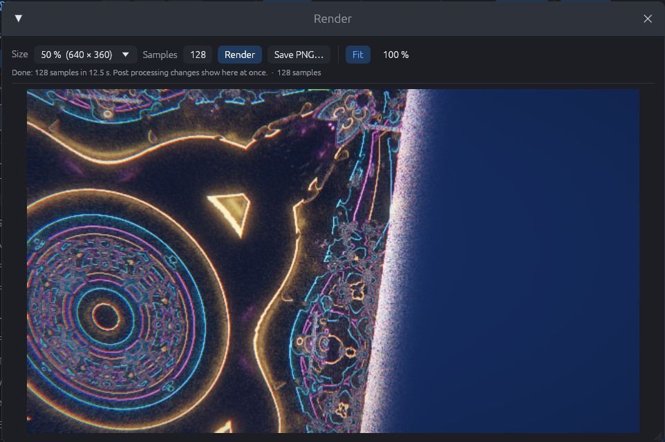
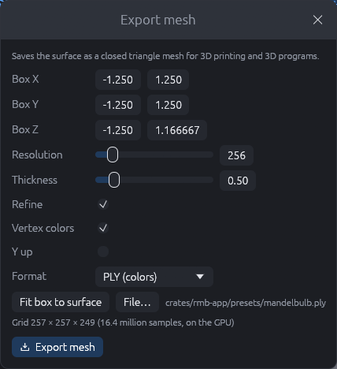

# Render and export

The preview in the view refines while you look at it, but it stops at a set number of samples
(Preferences › Preview › Samples) and shows the denoiser only when **Denoised** is on in the top
bar. For the final image there are three ways:

- the **render window** (<kbd>F12</kbd>): a test render with everything the export applies;
- the **export window** (<kbd>Ctrl</kbd>+<kbd>E</kbd>): renders and saves an image or an
  animation;
- the command line program **rmb-cli**, for renders without the user interface.

## Samples

Every *sample* is one complete pass over the image with slightly different random choices: a
different point inside each pixel (anti-aliasing), different occlusion and shadow rays, different
points on area lights and on the lens. The image is the average of all samples, so noise fades as
the count grows.

How many you need depends on the scene. With **Denoise** on (Effects › Image):

- **Still images**: 16–32 samples with the denoiser look cleaner than 64 without it, in a
  quarter to half of the time.
- **Animations**: the denoiser works frame by frame and rebuilds fine fractal detail slightly
  differently each time, which shimmers. At 16 samples this is about twice as much as 64 samples
  without the denoiser, at 32 samples 1.4 times as much. Use 64 samples (with or without the
  denoiser) for animations with much fine detail. Without the denoiser, the noise pattern stays
  the same from frame to frame and does not flicker.

Scenes with path tracing, glossy reflections, glass, light scattering, emissive light or motion
blur need more samples than plain classic shading.

## Render window

**Render** in the top bar or <kbd>F12</kbd> opens the render window and starts a render of the
current scene.



| Control | What it does |
|---------|--------------|
| **Size** | A share of the image size set in the Camera tab: 25 %, 50 % (default) or 100 %. |
| **Samples** | Samples per pixel (1–4096). Starts with the export samples of the preferences; double-click: 64. |
| **Render** | Renders the current scene again (<kbd>F12</kbd>). |
| **Cancel** | Stops rendering and keeps the image so far. |
| **Save PNG…** | Saves the image as shown, with the scene inside the PNG. |
| **Fit** / **100 %** | Scales the image to the window, or shows one image pixel per screen pixel (scroll to move). |

The image refines while it renders. It contains everything a saved image gets: the denoiser,
lens flares, bloom, streaks and all Image settings.

**Developing again.** When the render is done, the window keeps the raw image. Changing any
setting of the Image section (exposure, bloom, tint, denoise amount, …) develops this raw image
again in the background, so the change shows within moments, without rendering again. The
denoised image is kept as long as the denoise settings stay the same. Only **Display space**
changes the render itself; the window then asks you to render again.

!!! tip
    Use the render window at 25 % or 50 % to judge noise, bloom and color grading, then export
    at full size. While the render window or an export is busy, the preview pauses so the two do
    not compete for the graphics card.

## Export window

**Export** in the top bar, **File › Export image…** or <kbd>Ctrl</kbd>+<kbd>E</kbd> opens the
export window. When the scene has keyframes, two buttons at the top choose between **Image** and
**Animation**.


### Image

| Control | What it does |
|---------|--------------|
| **Width**, **Height** | Size in pixels (16–16384). Changing one changes the other with the scene's aspect. |
| **Scale** | ½×, 1×, 2×, 4× of the scene's image size. |
| **Samples** | Samples per pixel (1–1024). The default comes from **Preferences › Interface › Export samples** (128). |
| **File…** | Where to save the PNG. It defaults to the scene file's name. |
| **Render and save** | Renders in the background and saves. A progress bar shows the remaining time; **Cancel** stops it. |

Images are saved as PNG with the scene stored inside. Opening such a PNG in RMandelbulb3D (or
dropping it onto the window) restores the scene. When **Denoise** is on, the status message says
whether and where the image was denoised.

### Animation

The animation part has the same size and sample settings, plus:

| Control | What it does |
|---------|--------------|
| **Format** | MP4 (H.264), MP4 (H.265), MOV (ProRes), WebM (VP9), GIF or PNG images. Movie formats need ffmpeg and are grayed out without it. |
| **Frames** | First and last frame to render, both included. **All** selects all frames. |
| **Length** | Frames and duration at the animation's frame rate. |
| **File…** / **Folder…** | The movie file, or the folder for numbered PNG images. |

A line tells whether the animation's sound track goes into the movie, is left out (GIF and PNG
images have no sound) or cannot be found. While rendering, the window shows the last finished
frame.

Chapter "Animation" explains the formats, sound and motion blur.

!!! note
    The export window and the render window need the GPU renderer. Without a usable graphics
    card, render with `rmb-cli render --cpu`.

## Mesh export

**File › Export mesh…** saves the surface as a closed triangle mesh: for 3D printing, or to
use the fractal in Blender and other 3D programs. The distance estimate is sampled on a grid in
a box (on the GPU when there is one), and the surface between the samples becomes the mesh.
The export runs in the background; the preview pauses meanwhile.

{: .half}

| Setting | What it does | Default |
|---------|--------------|---------|
| Box X, Y, Z | The sampled box (from, to; world units). Opening the window fits it to the scene's surfaces; **Fit box to surface** does that again. Where the surface reaches the box, the mesh is closed by a flat cap, so cutting the box smaller exports a slice. | fitted |
| Resolution | Grid cells along the longest side of the box. The triangle count grows with its square: about 0.8 million at 256, 4 million at 512, 23 million at 1024 for the Mandelbulb. | 256 |
| Thickness | How far outside the fractal the surface lies, in grid cells. 0.5 keeps the shape; larger values thicken thin parts so they survive printing. | 0.5 |
| Refine | Moves every vertex onto the surface after the grid placed it: sharper edges, a little slower. | On |
| Vertex colors | The scene's colors at every vertex (gradient, color maps, texture layers, model colors; no lighting). PLY and OBJ only. | On |
| Y up | Writes y as the up axis. RMandelbulb3D uses z up, like Blender's PLY import; Blender's OBJ import and many other programs expect y up. | Off |
| Format | **PLY**: binary, small, with normals and colors (Blender, MeshLab). **OBJ**: text, colors as the `v x y z r g b` extension many programs read. **STL**: binary, for the slicers of 3D printers, no colors. | PLY |

The line below the settings shows the grid size and whether the GPU or the CPU computes it.
On an RTX A2000 laptop GPU the Mandelbulb takes about 1 s at 256 and 17 s at 1024 (most of it
writing the 600 MB file).

!!! tip
    Fine fractal detail smaller than a grid cell becomes a smooth skin. Export a smaller box
    at the same resolution for close-ups, and use **Thickness** above 1 for prints: thin
    filaments break otherwise.

!!! note
    The mesh is closed and every triangle faces outward, but a fractal's mesh can have very
    many small separate pieces (dust around the surface). Slicers and Blender's *Select linked*
    / *Delete loose* remove those. Inside rendering and deep zooms beyond about 10⁵ are not
    supported (the grid uses single precision on the GPU).

## Command line: rmb-cli

`rmb-cli` renders and converts scenes without the user interface. A *scene* is an `.rmb` file, a
Mandelbulb3D `.m3p` file, a text file with Mandelbulb3D clipboard parameters, or a PNG rendered by
RMandelbulb3D. Run `rmb-cli --help` for a summary.

### render

```
rmb-cli render <scene> [-o out.png] [-W width] [-H height] [-s samples] [--cpu] [-t threads]
               [--denoise [blend] | --no-denoise]
```

Renders one image and saves it as PNG with the scene inside.

| Option | What it does |
|--------|--------------|
| `-o out.png` | Output file. Default: the scene's name with `.png`. |
| `-W`, `-H` | Width and height. Default: the scene's size; giving only one keeps the aspect ratio. |
| `-s samples` | Samples per pixel (default 64). |
| `--cpu` | Renders on the CPU instead of the GPU: much slower, but always in double precision. |
| `-t threads` | Threads of the CPU renderer. |
| `--denoise [blend]` | Runs the denoiser whatever the scene says; blend 0–1, default 1. |
| `--no-denoise` | Skips the denoiser. |

### animate

```
rmb-cli animate <scene> [-o out.mp4|folder] [-W width] [-H height] [-s samples] [--cpu]
                [--fps n] [--from frame] [--to frame] [--denoise [blend] | --no-denoise]
                [--ffmpeg path] [--audio file [--audio-offset s] | --no-audio]
                [--shutter fraction]
```

Renders the scene's keyframe animation. The extension of `-o` picks the format: `.mp4` H.264,
`.mov` ProRes, `.webm` VP9, `.gif`; anything else is a folder of numbered PNG files. Default
output: the scene's name with `.mp4`.

| Option | What it does |
|--------|--------------|
| `--fps n` | Frame rate instead of the scene's. |
| `--from`, `--to` | First and last frame (both included). |
| `--ffmpeg path` | The ffmpeg program, if it is not on the search path. |
| `--audio file` | Sound track instead of the scene's; relative to the working folder. |
| `--audio-offset s` | Where in the sound frame 0 starts, in seconds. |
| `--no-audio` | Leaves the sound out. |
| `--shutter fraction` | Motion blur: exposure as a fraction of the frame time (0 = off, 0.5 = 180° shutter). |

`-W`, `-H`, `-s`, `--cpu` and the denoise options work as for `render`.

### mesh

```
rmb-cli mesh <scene> [-o out.ply|.obj|.stl] [-r resolution] [--box x0,y0,z0,x1,y1,z1]
             [--thickness cells] [--no-colors] [--no-refine] [--y-up] [--cpu]
```

Exports the surface as a mesh, like **File › Export mesh…**. The extension of `-o` picks the
format (default: the scene's name with `.ply`).

| Option | What it does |
|--------|--------------|
| `-r resolution` | Grid cells along the longest side of the box (default 256). |
| `--box x0,y0,z0,x1,y1,z1` | The sampled box. Default: fitted to the surface. |
| `--thickness cells` | How far outside the fractal the surface lies (default 0.5). |
| `--no-colors`, `--no-refine` | Without vertex colors / without moving the vertices onto the surface. |
| `--y-up` | Writes y as the up axis. |
| `--cpu` | Computes the distances on the CPU instead of the GPU. |

### Other commands

| Command | What it does |
|---------|--------------|
| `rmb-cli convert <scene> -o out.rmb` | Imports a scene (for example a Mandelbulb3D `.m3p`) and saves it as `.rmb`. |
| `rmb-cli info <scene>` | Prints the image size, camera, iteration settings, the formulas of the slots (marking missing ones) and the scene notes with import messages. |
| `rmb-cli formulas` | Lists all formulas by category, with their Mandelbulb3D names. |
| `rmb-cli m3f <dir or file>… [-o out.mbf] [-v]` | Translates Mandelbulb3D formula files (`.m3f`) into the formula language and writes all that translate into one file; prints how many failed and why. `-v` lists every failure. |

Examples:

```
rmb-cli render scene.rmb -o scene.png -W 3840 -s 32 --denoise
rmb-cli animate flight.rmb -o flight.mp4 -s 64 --shutter 0.5
rmb-cli mesh scene.rmb -o scene.stl -r 512 --thickness 1.5
rmb-cli convert old.m3p -o old.rmb
```
