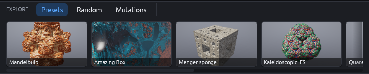
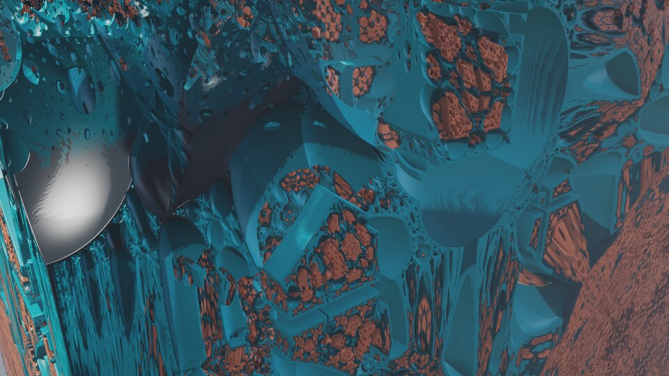
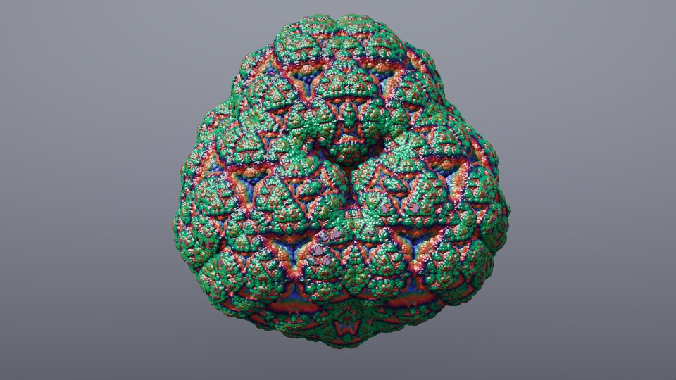
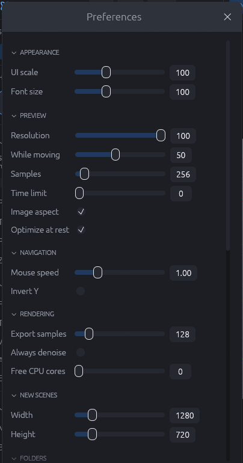

# Explore and preferences

This chapter covers the **explore lane**, a strip of thumbnails for finding new scenes, and the
**Preferences** window.

## The explore lane

Click **Explore** in the top bar to open the lane at the bottom of the window. It has three
pages, chosen with the buttons next to *EXPLORE*:

- **Presets**: scenes to start from.
- **Random**: batches of random fractals with random colors.
- **Mutations**: variants of the current scene.

The thumbnails render one after another in the background (on the graphics card, or on the CPU
without one), with a few samples each and without the denoiser and lens flares. A spinner shows
while a batch is still being made; scroll the strip sideways to see all thumbnails. Hold the
mouse over a thumbnail to see its formulas.

**Click a thumbnail to take its scene.** It replaces the current scene as one undo step, so
<kbd>Ctrl</kbd>+<kbd>Z</kbd> brings the previous scene back.

### Presets

The presets show the range of the program: *Mandelbulb*, *Amazing Box*, *Menger sponge*,
*Kaleidoscopic IFS*, *Quaternion Julia*, *Neon box city*, *Glass bulb* and *Hybrid*. They load
when the lane opens.

### Random

Choose the kind of fractal in the menu, set **Count** (random scenes per batch, 1–48, default 12)
and click **New batch**.

| Kind | What it makes |
|------|---------------|
| **Any** | Each scene picks one of the kinds below at random. |
| **Bulbs** | Mandelbulb-like formulas (Mandelbulb, Xenodreambuie, Folding bulb, …). |
| **Boxes** | Box formulas such as Amazing Box, Amazing Surf and ABox Mod Kali. |
| **IFS** | Menger sponge, Sierpinski tetrahedron, Kaleidoscopic IFS and similar. |
| **Hybrids** | A formula combined with a second one of the same family and/or a transform (rotate, box fold, abs) in front. |

Every random scene uses formulas with parameter ranges that give good results, gets a random
palette, and the camera is placed so that the fractal fills the view.

### Mutations

Mutations are variants of the scene you are working on. Choose what to change, set **Count**
(variants per click, 1–48) and **Strength** (how far the variants go from the current scene, 0–1,
default 0.5), then click **Mutate**.

| Mutation | What changes |
|----------|--------------|
| **Everything** | Each variant picks one of the kinds below at random. |
| **Formula parameters** | Some formula parameters move a little; sometimes the iteration count changes. |
| **Colors** | Either new random colors, or the gradient shifts and its hues turn. |
| **Camera** | The camera orbits around the point it looks at and moves a little closer or farther. |
| **Formulas** | A transform is put in front of the formulas, or a formula is swapped for another of the same family. |

While a batch runs, the button turns into **Cancel**: it stops making thumbnails, and the finished
ones stay.

!!! tip
    Mutations build on each other: take a variant you like, then mutate again from there. Lower
    the **Strength** as you get closer to what you want.

## Preferences

**Edit › Preferences…** opens the preferences. Changes apply and are saved at once. Like the
inspector, the window is divided into sections that open and close with a click on their title.

### Appearance

| Setting | What it does | Range / default |
|---------|--------------|-----------------|
| **UI scale** | Size of the whole interface in percent: texts, controls and spacing together. Lower it on small or high-resolution screens where everything looks too big. Applies when you let go of the slider. | 50–200, default 100 |
| **Font size** | Size of the texts only. Other values than 100 % can make texts overlap their controls; UI scale keeps the proportions. | 50–200, default 100 |

### Preview

| Setting | What it does | Range / default |
|---------|--------------|-----------------|
| **Resolution** | Preview resolution in percent of the view size. Lower is faster. | 25–100, default 100 |
| **While moving** | Resolution while you navigate, in percent of the preview resolution. | 10–100, default 50 |
| **Samples** | The preview stops refining after this many samples per pixel. | 1–4096, default 256 |
| **Time limit** | The preview stops refining after this many seconds (0: no limit). | 0–600 s, default 0 |
| **Image aspect** | Shows the preview in the aspect ratio of the image size; off: fills the view. | on |
| **Optimize at rest** | When the view and the settings rest for a moment, compiles a shader with all settings built in, in the background, and continues with it (below). | on |

**Optimize at rest.** While you edit, the preview reads every setting from memory, so a change
shows at once. When nothing changes for a moment (about 0.7 seconds), the program compiles a
specialized shader with all current settings written into it and switches to it without
starting over. The image stays the same, but passes are often 5–30 % faster, because features
that are off drop out of the shader. The cost is a compile of about a second after each change.

### Navigation

| Setting | What it does | Range / default |
|---------|--------------|-----------------|
| **Mouse speed** | Sensitivity of orbiting and looking with the mouse. | 0.1–4, default 1 |
| **Invert Y** | Inverts the vertical mouse direction. | off |

### Rendering

| Setting | What it does | Range / default |
|---------|--------------|-----------------|
| **Export samples** | Default samples per pixel of exported images and the render window. | 1–1024, default 128 |
| **Always denoise** | Scenes that come in without the denoiser (new, opened, pasted, from the explore lane) get it, with **Denoise amount**. Scenes that use it already keep their setting. | off |
| **Free CPU cores** | CPU cores the CPU work (CPU renderer, 3D model baking, framing random scenes) leaves free for other programs. Takes effect at the next start. | default 0 |

### New scenes

**Width** and **Height**: the image size of scenes made with **File › New** (default 1280 × 720).

### Folders

Start folders of the file dialogs per kind of file: scenes, saved images, movies, 3D models,
textures and backgrounds, sound tracks. Without a folder, a dialog starts where you were last.
**Quick save** sets where **File › Quick save** (<kbd>Ctrl</kbd>+<kbd>Alt</kbd>+<kbd>S</kbd>)
puts scenes: it saves without asking, named `qsave_<date>_<time>.rmb` (else in the Scenes
folder, else in the configuration folder).

### Explore

**Batch size**: scenes per new batch of random fractals or mutations in the explore lane.

### Formulas

This section shows the folder your own formulas (`*.mbf`) are loaded from at start: the
`formulas` folder in the configuration folder (chapter "Reference").

- **Open folder** opens it in the file manager and creates it if needed.
- **Reload formulas** loads the formula files again, after you edited them outside the program.
- **Import .m3f…** asks for a folder with Mandelbulb3D formula files (`*.m3f`, also JIT
  formulas), translates them and adds those that translate to the library for this session. A
  message tells how many were added and how many could not be translated.

!!! note
    Formulas imported with **Import .m3f…** are gone after a restart, but a scene saved with them
    carries their code, so it opens again anywhere. Most Mandelbulb3D formulas are already built
    in (chapter "Mandelbulb3D import"); the formula editor is described in chapter "The formula
    editor".

### Maps

Some Mandelbulb3D formulas read images (height maps and others) by number from Mandelbulb3D's
`M3Maps` folder. Color maps, texture layers and background images can use those numbers or file
names in the map folders too.

- **Choose folder…** sets the `M3Maps` folder (files named by their number, for example
  `10.jpg`).
- **Clear** returns to the default folders only.

After this folder, the program also looks in the folder given by the environment variable
`RMB_MAPS_DIR` and in a `maps` or `M3Maps` folder next to the program.

### Movies

Movie files (MP4, MOV, WebM, GIF) are written by the free program **ffmpeg**. The section says
whether ffmpeg was found on the search path.

- **Choose ffmpeg…** picks the ffmpeg program by hand.
- **Clear** uses ffmpeg from the search path again.

Without ffmpeg, animations can still be saved as PNG images.

### What else is remembered

Besides the settings above, the preferences keep the list of recent files (**File › Open
recent**, up to 12), the last folder used in file dialogs, and which inspector sections you
closed.
