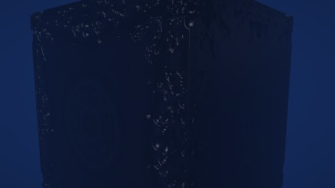
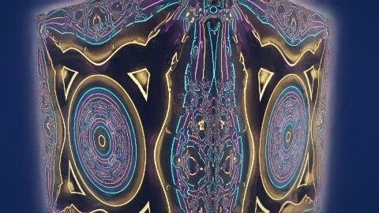
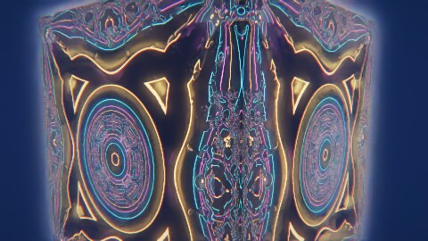
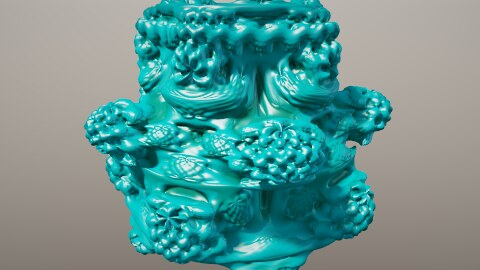
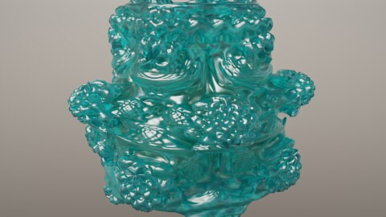
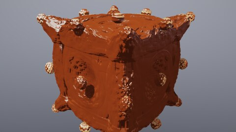
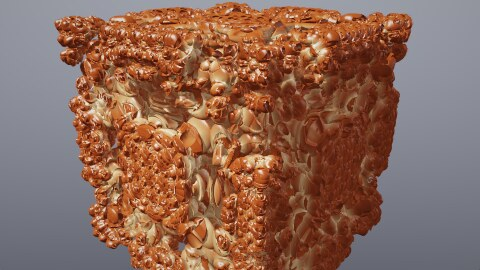
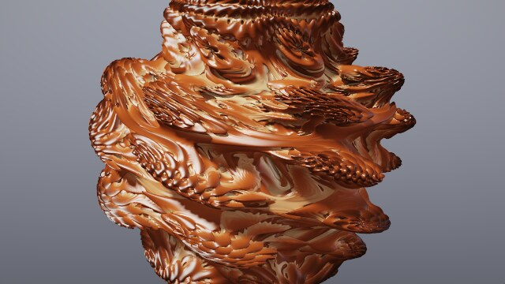
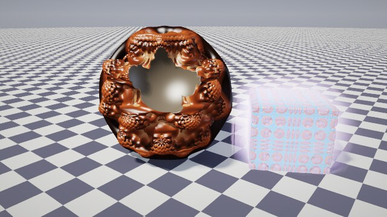
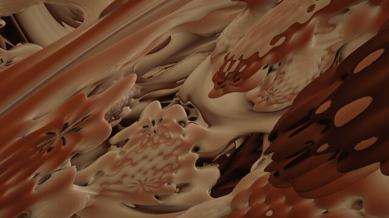

# How-tos

The how-tos in this chapter take you from an idea to a finished picture, step by step, with the
values used for the pictures. Every example scene is in the folder `docs/manual/examples` of the
source code: open one with **File › Open…** (or drag it onto the window) and compare it with
your own attempt. The pictures were rendered with 48 samples and the denoiser.

!!! tip
    Most settings show their meaning when you hold the mouse over them, and a double-click
    resets a value to its default. Ctrl+Z takes back any step.

## Your first image in five minutes

1. Open the explore lane (**Explore** in the top bar) and click the **Mandelbulb** preset.
2. In the scene panel, change **Power** of slot 1 from 8 to 5: the bulb gets fewer, larger
   lobes. Try 3 and 12 as well.
3. On the **Color** tab, click **Random** next to the gradient a few times until you like the
   colors. The **Generator** below it decides what kind of palettes Random makes: pick
   *Complementary* for strong contrast or *Monochrome* for a calm look.
4. Turn the view: drag with the left mouse button to orbit, use the wheel to move closer.
   A double-click on the surface turns the camera toward that point and sets the focus there.
5. Press <kbd>F12</kbd> to open the render window. It renders the image with everything an
   export does (denoiser, bloom, lens flares) and shows changes to the Image settings at once.
6. **Export** (<kbd>Ctrl</kbd>+<kbd>E</kbd>) saves the image. The PNG contains the whole scene:
   open it later with **File › Open…** to continue where you left off.

## Neon lines in a blue haze

Dark structures with thin glowing lines and a blue haze, in the style of Julius Horsthuis'
fractal films. The **Neon box city** preset is the result; here is how it is built.
Example scenes: `neon-step1.rmb` … `neon-step4.rmb`.

### Step 1: a dark structure

Start with an Amazing Box (**Main fractal**, slot 1: *Amazing Box*, **Scale** −1.5,
**Min radius** 0.5; **Max iterations** 24, **Bailout** 16). Make everything dark:

| Where | Setting | Value |
|-------|---------|-------|
| Color › Gradient | three colors | dark blue-gray (10, 12, 20), (28, 34, 52), (10, 12, 20) |
| Lighting | light intensity | 0.25 of the default |
| Lighting › Ambient | Amount, Sky | 0.25, blue (0.2, 0.35, 0.8) |
| Effects › Background | Top, Horizon, Bottom | almost black blues |
| Effects › Fog and glow | Fog density, Fog color | 0.1, dark blue |

{: .half}

### Step 2: glowing lines

The lines come from **glow bands**: narrow stripes on the gradient that shine by themselves.
Where a band's position meets the surface coloring, a thin line of light runs over the fractal.

1. On the **Color** tab, set **Mapping › Color by** to *Orbit trap* and **Scale** to 0.45.
   With box fractals, *Iterations* gives almost the same value everywhere on the surface (most
   surface points reach the maximum iterations), so bands would not show; the orbit trap
   changes across the surface.
2. Add three glow bands (the **+** next to GLOW BANDS):

| Band | Position | Width | Soft | Color | Emission |
|------|----------|-------|------|-------|----------|
| 1 | 0.20 | 0.012 | 0.4 | cyan | 4 |
| 2 | 0.52 | 0.012 | 0.4 | magenta | 4 |
| 3 | 0.80 | 0.012 | 0.4 | orange | 4 |

{: .half}

The width decides how thin the lines are; a lower **Scale** under Mapping makes fewer, wider
apart lines, a higher one more and denser lines.

### Step 3: haze and finish

| Where | Setting | Value |
|-------|---------|-------|
| Effects › Fog and glow | Fractal haze | 0.8 |
| | Haze shape, Haze reach | Distance, 0.02 |
| | Haze glow, Haze color | 0.8, blue (0.05, 0.25, 1.0) |
| Effects › Image | Bloom, Bloom threshold | 0.6, 0.8 |
| | Chromatic aberration | 0.5 |

The fractal haze hugs the surfaces and fills the gaps with a blue glow; bloom lets the lines
shine into their surroundings, and the chromatic aberration adds the colored fringes of a lens.

{: .half}

!!! tip
    Glowing lines need samples: let the preview refine, and render with 64 or more samples and
    the denoiser. Animate the lines with **Mapping › Rotation** or each band's **Speed**: they
    then wander over the structures.

## A glass fractal

Fractals of colored glass refract and reflect what lies behind them. Example scenes:
`glass-before.rmb`, `glass-after.rmb`.

1. Pick a fractal with an open, airy shape, e.g. the Mandelbulb with **Power** 6.
2. On the **Color** tab, give every gradient color a transparency (the value next to each
   color when **Glass** is on; 0.92 in the picture).
3. Under **Mapping**: **Reflection** 1.0, **Bounces** 4, **Glass** on, **Refraction index**
   1.5, **Absorption** 0.4. Absorption tints thick parts with the surface color.
4. A bright horizon behind the fractal (Effects › Background) makes the refraction visible.

{: .half}

{: .half}

Glass costs more rays per sample: the render window and the export need more samples for a
clean image than an opaque fractal.

## A hybrid that changes its formula

Mandelbulber's per-slot iteration ranges let one formula shape the coarse structure and another
the fine detail. Example scenes: `hybrid-alternating.rmb`, `hybrid-ranges.rmb`.

1. Slot 1: *Amazing Box*, **Scale** −1.8, **Min radius** 0.5. Slot 2: *Mandelbulb*, power 8.
   **Max iterations** 14, **Bailout** 16.
2. As they are, the two formulas take turns every iteration (left picture).
3. Select slot 1 and open **Slot 1 settings**: tick **To iteration** and set it to 2. Select
   slot 2 and set **From iteration** to 3. Now the box shapes the first three iterations, and
   the bulb adds its detail on top (right picture).

{: .half}

{: .half}

Other per-slot settings to try: **Weight** below 1 blends a formula's result with the point
before it (soft transitions between formulas), and turning off **Add C** lets a formula only
reshape the point without adding the constant.

## Writing your own formula

Example scene: `twisted-bulb.rmb` (it carries the formula's code, so it opens anywhere).

1. Select a slot with the Mandelbulb and click **Edit code**. The formula editor opens with a
   copy named *Mandelbulb custom*.
2. Replace the text with the following formula: a power bulb that twists around the z axis,
   more the higher the point lies.

```
formula "Twisted bulb" {
    category "My formulas"
    description "A power bulb that twists around the z axis, more with the height."
    de log
    param power "Power" = 8 [2, 16]
    param twist "Twist" = 1.5 [-4, 4]
    iter {
        let a = z * twist
        let tx = x * cos(a) - y * sin(a)
        y = x * sin(a) + y * cos(a)
        x = tx
        let r = max(sqrt(x * x + y * y + z * z), 1.0e-20)
        let theta = acos(clamp(z / r, -1.0, 1.0)) * power
        let phi = atan2(y, x) * power
        dr = power * pow(r, power - 1.0) * dr + 1.0
        let zr = pow(r, power)
        x = zr * sin(theta) * cos(phi) + cx
        y = zr * sin(theta) * sin(phi) + cy
        z = zr * cos(theta) + cz
    }
}
```

3. Click **Apply** (<kbd>Ctrl</kbd>+<kbd>Enter</kbd>). The slot switches to *Twisted bulb*, and
   its **Power** and **Twist** appear as sliders in the scene panel.
4. **Save as file** stores it in your formula folder, so it is in the formula list at every
   start. Scenes that use it carry its code anyway.



When the text has an error, the editor names the line and marks it in the line numbers. The
chapter "The formula editor" lists all statements and functions.

## Combining fractals and shapes

Example scene: `composition.rmb`. Objects in the scene list are combined with the main fractal
in order: added, cut away or intersected, also smoothly. The example has a Mandelbulb as the
main fractal and four objects: a small Amazing Box fractal (*Add*), a ground plane (*Add*), a
shape that carves into the bulb (*Cut away*) and a ring that melts into it (*Add smoothly*).

1. Click **+** next to SCENE and add a shape, e.g. a *Sphere*. It appears in front of the
   camera.
2. Move it with the gizmo in the view (**Move** in the top bar), or type its position under
   **Placement**.
3. Set its **Operation** to *Cut away*: the shape now carves a hole into the fractal. The
   smooth variants blend the edges; their smoothing sets how wide.
4. Give it **Own colors** under Material to set it apart, e.g. a pattern or an emissive color.
5. Add a *Plane* with *Add* as a floor, or a second fractal (*Fractal* in the + menu) with its
   own formulas.



## A deep zoom

Example scene: `deep-zoom.rmb` (100 000 times closer than the Mandelbulb preset).

1. Turn the camera toward a part with fine detail (between the bulbs is a good place).
2. Fly toward the surface: in **Fly** mode the speed follows the distance to the surface, so
   you can keep going without overshooting. Double-click to aim at a point.
3. Raise **Max iterations** as you go: close up, the surface needs more iterations to show its
   detail (40 in the picture instead of 12).
4. Beyond a zoom of a few thousand, **Ray marching › Precision** *Auto* switches to double
   precision. The first shader for it takes a while to compile, and renders are slower, but
   the surface stays sharp to a zoom of about 10¹¹.



## A smooth camera flight

1. Open the timeline (**Animation** in the top bar).
2. Switch the view to **Fly** mode and click **Record flight**. Fly through the scene with
   <kbd>W</kbd><kbd>A</kbd><kbd>S</kbd><kbd>D</kbd> and the mouse; keyframes are made
   automatically while you fly.
3. Choose **Steady** timing: the camera then moves at an even speed between all keyframes,
   without speeding up and slowing down at every keyframe.
4. Turn on the **cameraman** smoothing: it takes the jerks of keys and mouse out of the path,
   like a professional camera operator.
5. Play it back, then **Export animation…** as a movie (needs ffmpeg) or as PNG frames.

The chapter "Animation" explains timing, easing, motion blur and sound tracks.
